# Tugas 4 (Pekan 4) — Komunikasi Antar Komponen

**Materi terkait:** Remote Procedure Call (RPC), Message-Oriented Middleware (MOM)/Message Queue.

## Pembagian Kerja
 
| Nama | NIM | Yang dikerjakan |
|---|---|---|
| Duarte Sebastian Napitupulu | 103072400152 | consumer.py, client.py, server.py, dokumentasi bukti, analisis jurnal & readme |
| Chaesar Pratama | 103072400119 | publisher.py & Dokumentasi bukti |
| Didit Septa Putra | 103072400071 | Pengujian dan bukti |
| Alif Rifqi Pratama | 103072400133 |  Analisis tambahan, pengujian dan merapikan laporan |

## Studi Kasus
 
Modul **Pembayaran** dan modul **Pesanan** FoodGo harus berkomunikasi secara reliabel. Untuk beberapa operasi (mis. cek status saldo) respons dibutuhkan **seketika** (sinkron). Untuk operasi lain (mis. kirim notifikasi "pembayaran berhasil" ke modul kurir) sistem **tidak boleh menunggu** — modul pembayaran harus tetap responsif walau modul kurir sedang sibuk/down (asinkron).
 
## Jalur yang Kami Pilih
 
Kami mengerjakan **kedua jalur**, masing-masing untuk kebutuhan yang berbeda:
 
| Jalur | Komunikasi | Kenapa |
|---|---|---|
| **A — RPC** (`rpc/`) | Pesanan → Pembayaran (`cek_saldo`, `proses_pembayaran`) | Pesanan butuh jawaban saat itu juga |
| **B — Message Queue** (`mq/`) | Pembayaran → Kurir (`pembayaran_berhasil`) | Pembayaran tidak butuh balasan dan tidak boleh menunggu |
 
Cara menjalankan Jalur A (tidak perlu install apa pun):
 
```bash
python rpc/server.py          # terminal 1: modul Pembayaran
python rpc/client.py          # terminal 2: modul Pesanan
```
 
Cara menjalankan Jalur B:
 
```bash
cd mq
docker compose up -d          # broker RabbitMQ lokal
pip install -r requirements.txt
python consumer.py            # terminal 1: modul Kurir
python publisher.py           # terminal 2: modul Pembayaran
```
 
---
 
## 1. Jalur A — RPC
 
### 1.1 Penyelesaian `# TODO`
 
`rpc/server.py` — modul Pembayaran:
 
```python
LAMA_PROSES = 5   # server sengaja dibuat "sibuk" 5 detik per panggilan
 
 
def cek_saldo(user_id: str) -> float:
    # TODO 1
    print(f"[server] cek_saldo({user_id}) diterima, memproses {LAMA_PROSES} detik...")
    time.sleep(LAMA_PROSES)
 
    if user_id not in saldo_user:
        raise ValueError(f"user {user_id} tidak ditemukan")
 
    print(f"[server] cek_saldo({user_id}) selesai, balasan dikirim")
    return saldo_user[user_id]
 
 
def proses_pembayaran(user_id: str, jumlah: float) -> dict:
    # TODO 2
    print(f"[server] proses_pembayaran({user_id}, {jumlah}) diterima")
 
    if user_id not in saldo_user:
        raise ValueError(f"user {user_id} tidak ditemukan")
 
    if saldo_user[user_id] < jumlah:
        return {"status": "gagal", "saldo_akhir": saldo_user[user_id]}
 
    saldo_user[user_id] = saldo_user[user_id] - jumlah
    print(f"[server] saldo {user_id} SUDAH DIPOTONG, sisa {saldo_user[user_id]}")
 
    print(f"[server] menyiapkan balasan {LAMA_PROSES} detik...")
    time.sleep(LAMA_PROSES)
 
    print("[server] proses_pembayaran selesai, balasan dikirim")
    return {"status": "sukses", "saldo_akhir": saldo_user[user_id]}
 
 
def main():
    # TODO 3
    server = SimpleXMLRPCServer(("localhost", 8000))
    server.register_function(cek_saldo)
    server.register_function(proses_pembayaran)
    print("RPC server modul Pembayaran berjalan di port 8000...")
    server.serve_forever()
```
 
`rpc/client.py` — modul Pesanan:
 
```python
def main():
    # TODO 1
    proxy = xmlrpc.client.ServerProxy("http://localhost:8000")
 
    start = time.time()
    try:
        print("Memanggil cek_saldo('user1') ... menunggu respons sinkron")
        # TODO 2
        saldo = proxy.cek_saldo("user1")
        print(f"  -> saldo user1 = {saldo} (menunggu {time.time() - start:.1f} detik)")
 
        start = time.time()
        print("Memanggil proses_pembayaran('user1', 20000) ...")
        # TODO 3
        hasil = proxy.proses_pembayaran("user1", 20000)
        print(f"  -> hasil = {hasil} (menunggu {time.time() - start:.1f} detik)")
 
    except Exception as e:
        print(f"  [!] GAGAL setelah menunggu {time.time() - start:.1f} detik")
        print(f"      Error: {type(e).__name__}: {e}")
        print("      Client tidak mendapat balasan apa pun dari server.")
```
 
Keputusan kami:
 
- **User tidak dikenal → error, bukan `return 0`.** Saldo 0 artinya "user ada tetapi tidak punya uang". Itu berbeda dengan "user tidak ada".
- **Saldo tidak cukup → `{"status": "gagal"}`.** Ini hasil yang wajar, bukan kerusakan sistem.
- **Server diberi jeda 5 detik.** Supaya terlihat bahwa client ikut menunggu, dan ada waktu untuk mematikan server di tengah proses.
### 1.2 Uji 1 — Client menunggu balasan (bukti sinkron)
 
Server (kiri) dan client (kanan) dijalankan berdampingan. Client menunggu **7.0 detik** untuk `cek_saldo` dan **7.1 detik** untuk `proses_pembayaran`: 5 detik kerja server ditambah ± 2 detik membuka koneksi. Selama itu client tidak bisa melakukan hal lain.
 
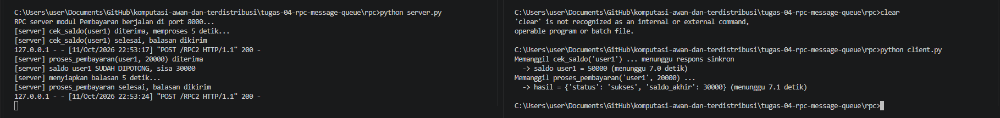
 
### 1.3 Uji 2 — Server mati sebelum dipanggil
 
Client dijalankan tanpa server. Client gagal setelah 4.1 detik dengan `ConnectionRefusedError`. Permintaannya tidak disimpan di mana pun.
 
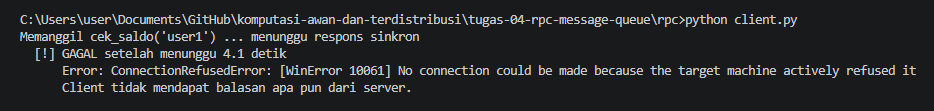
 
### 1.4 Uji 3 — Server mati di tengah proses
 
Terminal server kami tutup tepat setelah muncul `saldo user1 SUDAH DIPOTONG, sisa 30000`.
 
Di sisi **server**, saldo sudah dipotong, tetapi baris `balasan dikirim` tidak pernah muncul:
 
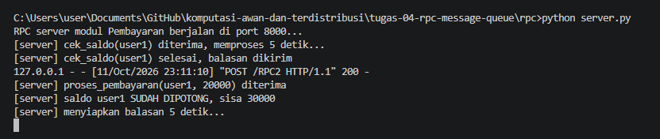
 
Di sisi **client**, yang diterima hanya `[!] GAGAL setelah menunggu 10.4 detik`:
 
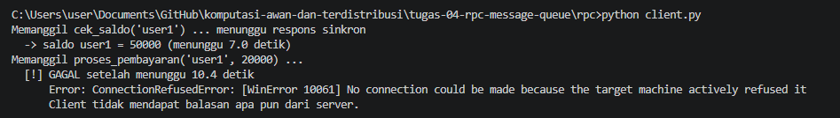
 
Jadi client mengira pembayaran gagal, padahal saldo sudah terpotong. Error-nya pun sama persis dengan Uji 2 (`ConnectionRefusedError`), sehingga client tidak bisa membedakan "belum diproses" dengan "sudah diproses".
 
---
 
## 2. Jalur B — Message Queue
 
### 2.1 Penyelesaian `# TODO`
 
`mq/publisher.py` — modul Pembayaran:
 
```python
def main():
    # TODO 1: koneksi ke RabbitMQ, lalu buat channel
    connection = pika.BlockingConnection(pika.ConnectionParameters(host="localhost"))
    channel = connection.channel()
 
    # TODO 2: deklarasikan queue yang durable
    channel.queue_declare(queue=QUEUE_NAME, durable=True)
 
    for i in range(1, 4):
        pesan = {
            "user_id": f"user{i}",
            "jumlah": 20000 * i,
            "timestamp": time.time(),
        }
        # TODO 3: publish pesan dan cetak log
        channel.basic_publish(
            exchange="",
            routing_key=QUEUE_NAME,
            body=json.dumps(pesan),
            properties=pika.BasicProperties(
                delivery_mode=pika.DeliveryMode.Persistent  # pesan disimpan ke disk
            ),
        )
        print(f"[x] Event terkirim: {pesan}")
        time.sleep(1)
 
    # TODO 4: tutup koneksi
    connection.close()
    print("Publisher selesai mengirim event.")
```
 
`mq/consumer.py` — modul Kurir:
 
```python
def callback(ch, method, properties, body):
    try:
        pesan = json.loads(body)
        if not isinstance(pesan, dict):
            raise ValueError("isi pesan bukan JSON object")
    except ValueError as e:
        print(f"[!] Pesan tidak valid, dibuang: {body!r} ({e})")
        ch.basic_reject(delivery_tag=method.delivery_tag, requeue=False)
        return
 
    # TODO 1: proses pesan
    user_id = pesan.get("user_id")
    jumlah = pesan.get("jumlah")
    print(f"[x] Kurir menerima notifikasi pembayaran untuk {user_id} sejumlah {jumlah}")
 
    # TODO 2: kirim acknowledgement supaya pesan dihapus dari antrean
    ch.basic_ack(delivery_tag=method.delivery_tag)
 
 
def main():
    # TODO 3: koneksi, channel, deklarasi queue yang sama, daftarkan callback
    connection = pika.BlockingConnection(pika.ConnectionParameters(host="localhost"))
    channel = connection.channel()
    channel.queue_declare(queue=QUEUE_NAME, durable=True)
    channel.basic_qos(prefetch_count=1)
    channel.basic_consume(queue=QUEUE_NAME, on_message_callback=callback, auto_ack=False)
 
    print("Menunggu event dari antrean 'pembayaran_berhasil'... (Ctrl+C untuk berhenti)")
 
    # TODO 4: mulai mendengarkan antrean
    try:
        channel.start_consuming()
    except KeyboardInterrupt:
        print("\nConsumer dihentikan.")
        channel.stop_consuming()
    finally:
        connection.close()
```
 
Keputusan kami:
 
- **`durable=True` + `delivery_mode=Persistent`.** Yang pertama menjaga queue-nya, yang kedua menjaga isi pesannya. Dua-duanya perlu supaya pesan tersimpan di disk.
- **`auto_ack=False`.** Pesan baru dihapus dari antrean setelah consumer selesai memprosesnya.
- **Pesan yang bukan JSON dibuang.** Kalau dikembalikan ke antrean, pesan rusak itu akan terus dikirim ulang.
### 2.2 Bukti program berjalan
 
**Publisher dan consumer hidup bersamaan.** Tiga event dari publisher (kiri) langsung diterima consumer (kanan):
 
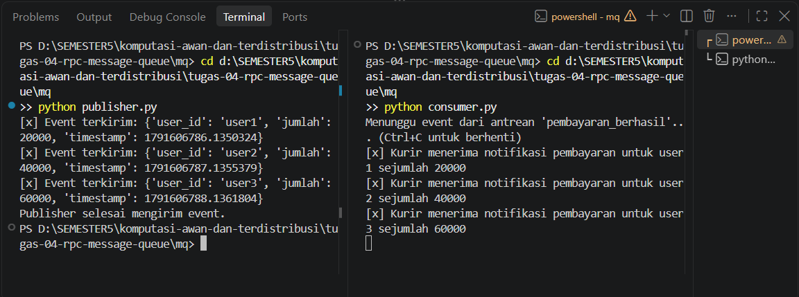
 
**Publisher saja, tanpa consumer.** Tiga event terkirim dan program selesai tanpa menunggu siapa pun:
 
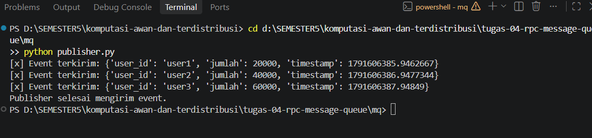
 
Tiga event itu terlihat di dashboard sebagai **Ready: 3**, dan queue-nya bertanda **D** (durable):
 
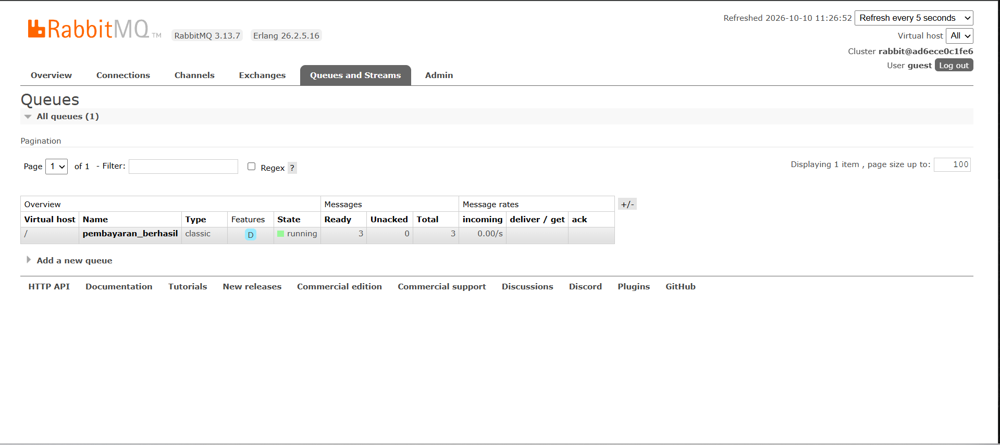
 
**Pesan ditandai persistent.** Pesan uji yang kami ambil lewat menu *Get messages* punya `delivery_mode: 2`:
 
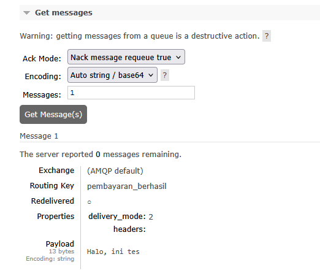
 
**Pesan tidak valid tidak membuat consumer mati.** `Halo ini bukan json` dan `123` dibuang, lalu pesan valid untuk `user9` tetap diproses:
 
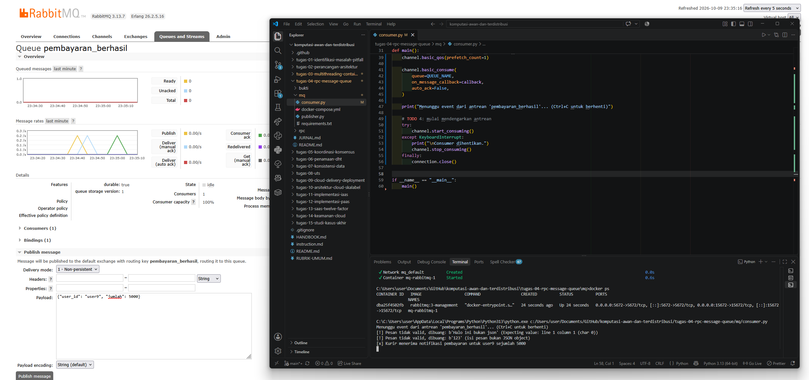
 
### 2.3 Uji "pesan tidak hilang" (*asynchronous decoupling*)
 
**Langkah 1 — consumer dimatikan, publisher dijalankan dua kali.** Total 6 event terkirim. Publisher selesai normal walau tidak ada penerima.
 
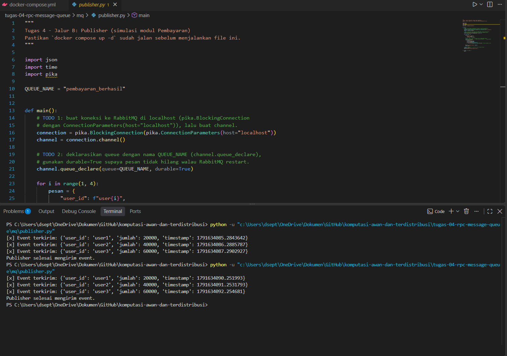
 
**Langkah 2 — pesan menumpuk di broker.** Dashboard menunjukkan **Ready: 6**, **Consumers: 0**, **Persistent: 6**, `durable: true`, dan ukuran total **418 B**. Enam pesan JSON kami memang berukuran 70 + 70 + 70 + 69 + 70 + 69 = 418 byte.
 
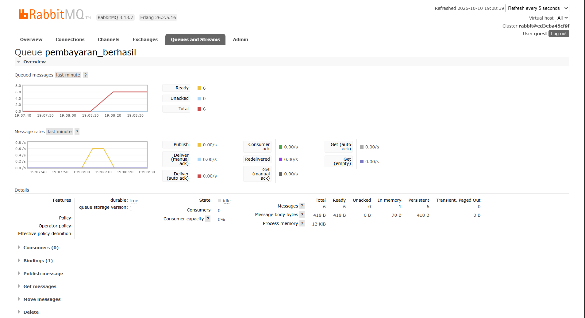
 
**Langkah 3 — consumer dinyalakan lagi.** Keenam pesan langsung diproses sesuai urutan kirim, tanpa publisher dijalankan ulang.
 
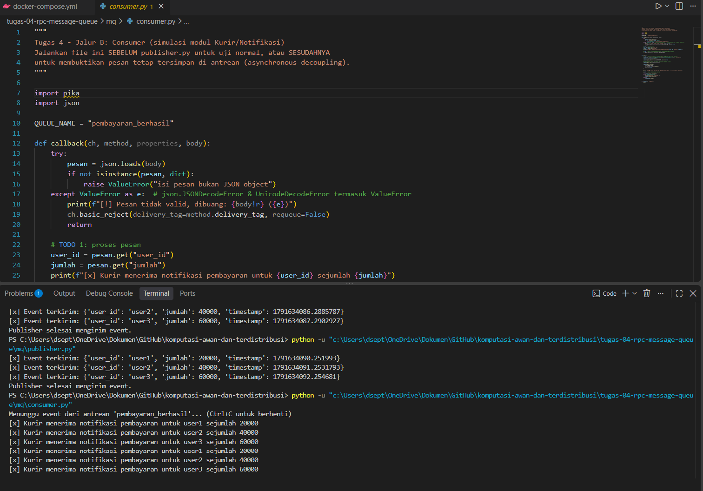
 
**Langkah 4 — antrean kosong lagi.** **Ready: 0**, **Consumers: 1**. Grafik turun dari 6 ke 0 bersamaan dengan lonjakan *Consumer ack*.
 
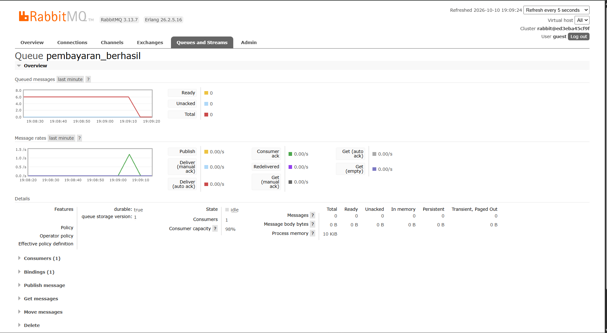
 
**Kesimpulan:** 6 pesan dikirim saat penerima mati, menunggu di broker sekitar satu menit, lalu keenamnya diproses. Tidak ada yang hilang.
 
---
 
## 3. Analisis Pemilihan Pola Komunikasi
 
### A. Kenapa RPC untuk cek saldo dan proses pembayaran
 
Modul Pesanan tidak bisa lanjut tanpa jawabannya: pesanan baru boleh dibuat kalau saldo cukup. Di Uji 1, client menunggu lalu langsung mendapat `saldo user1 = 50000` dan bisa mengambil keputusan. Menunggu di sini memang yang dibutuhkan.
 
### B. Kenapa Message Queue untuk notifikasi kurir
 
Modul Pembayaran tidak butuh jawaban dari Kurir. Di uji 2.3, publisher selesai normal padahal Consumers: 0, dan 6 pesannya tetap sampai setelah consumer hidup. Pembayaran tidak terganggu, notifikasi tidak hilang.
 
### C. Kalau polanya tertukar
 
**RPC dipakai untuk notifikasi kurir:**
 
- Kurir lambat → Pembayaran ikut lambat. Di Uji 1, client tertahan ± 7 detik per panggilan selama server bekerja.
- Kurir mati → notifikasi hilang. Di Uji 2, client langsung gagal dan permintaannya tidak tersimpan. Di MQ, kondisi yang sama berakhir dengan 6 dari 6 pesan tetap sampai.
**MQ dipakai untuk cek saldo:**
 
- Pesanan harus mengirim pesan, lalu menunggu balasan di antrean lain. Lebih rumit untuk hal yang sederhana.
- Kalau Pembayaran mati, permintaan hanya mengantre dan pelanggan menunggu tanpa kepastian. Lebih baik gagal cepat seperti di Uji 2.
### D. Ringkasan
 
| | RPC (sinkron) | Message Queue (asinkron) |
|---|---|---|
| Pemanggil butuh jawaban sekarang? | Ya | Tidak |
| Penerima mati | Pemanggil langsung gagal (Uji 2) | Pesan menunggu di antrean (uji 2.3) |
| Penerima lambat | Pemanggil ikut lambat (Uji 1) | Pengirim tetap cepat |
| Kami pakai untuk | `cek_saldo`, `proses_pembayaran` | notifikasi `pembayaran_berhasil` |
 
### E. Kelemahan masing-masing
 
**RPC**
 
- Pemanggil bergantung penuh pada server: server lambat atau mati, pemanggil ikut kena.
- Kalau server mati di tengah proses, hasilnya tidak jelas. Di Uji 3, client menerima error padahal saldo sudah dipotong. Kalau client mengulang, saldo bisa terpotong dua kali.
**Message Queue**
 
- Tidak ada jawaban langsung: publisher hanya tahu pesan sampai di broker, bukan bahwa Kurir sudah memprosesnya.
- Broker harus selalu hidup. Kurir boleh mati, tetapi kalau RabbitMQ mati, publisher gagal tersambung.
- `docker-compose.yml` kami tidak memakai volume, jadi pesan hilang kalau container dihapus (`docker compose down`). Ini tidak kami uji; kami tulis sebagai batasan.
---

## Struktur Submission

```
tugas-04-rpc-message-queue/
├── README.md      # Analisis: kenapa sinkron/asinkron, hasil uji "pesan tidak hilang"
├── JURNAL.md
├── rpc/            # Jalur A (jika dikerjakan)
├── mq/             # Jalur B (jika dikerjakan)
└── bukti/
```

## Rubrik Penilaian (Tugas 4)

| Komponen | Bobot | Kriteria |
|---|---|---|
| Implementasi berjalan (minimal 1 jalur) | 35% | RPC call sukses dapat balasan, ATAU pesan MQ sukses dikonsumsi |
| Bukti *asynchronous decoupling* (khusus Jalur B) / bukti sinkron blocking (Jalur A) | 25% | Skenario consumer mati lalu nyala lagi (B), atau bukti client menunggu response (A) |
| Analisis pemilihan pola komunikasi | 25% | Justifikasi tepat berdasarkan kebutuhan sinkron vs asinkron di skenario |
| Proses & kontribusi kelompok | 15% | `JURNAL.md`, commit history |

## Batasan Penggunaan AI (Level 2)

Kebijakan **Level 2 (AI Assisted Idea Generation & Structuring)** berlaku — lihat [`../RUBRIK-UMUM.md`](../RUBRIK-UMUM.md). Boleh bertanya konsep umum RPC/message queue ke AI; **tidak boleh** meminta AI menuliskan isi `# TODO` di `rpc/server.py`, `rpc/client.py`, `mq/publisher.py`, atau `mq/consumer.py`. Catat pemakaian AI di "Log Penggunaan AI" pada `JURNAL.md`.

- `JURNAL.md` wajib menjelaskan apa yang terjadi pada request RPC jika server mati di tengah proses (Jalur A), atau ke mana pesan "hilang sementara" tersimpan saat consumer mati (Jalur B) — jawaban generik/hafalan istilah tanpa mengaitkan ke hasil percobaan sendiri akan dinilai rendah.
