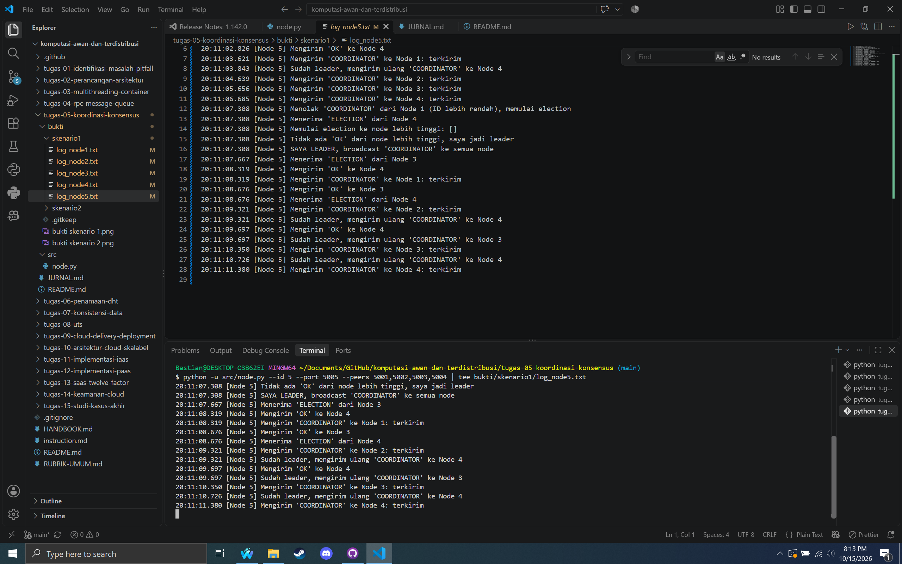
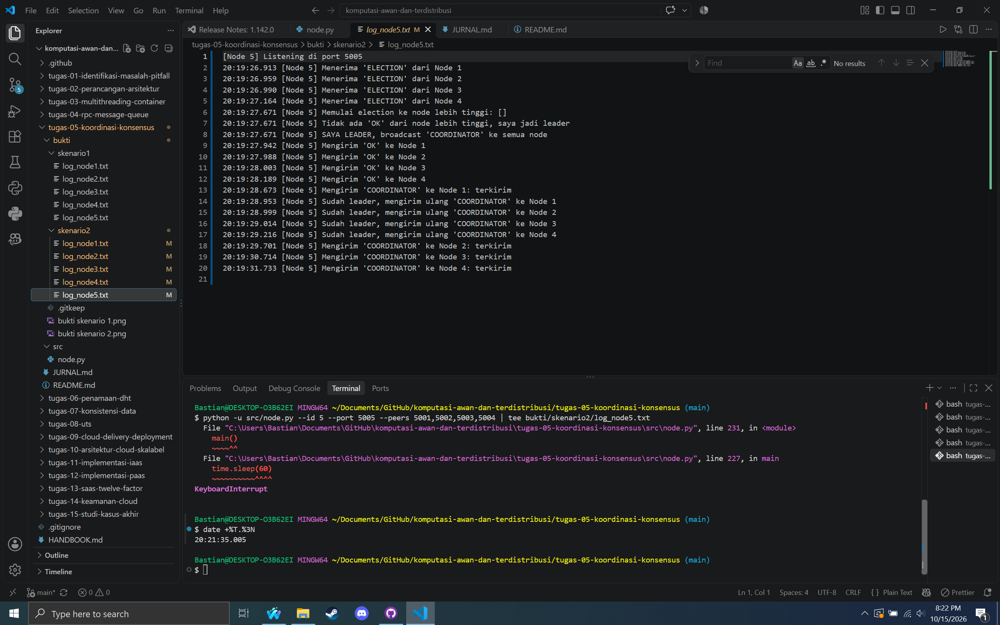
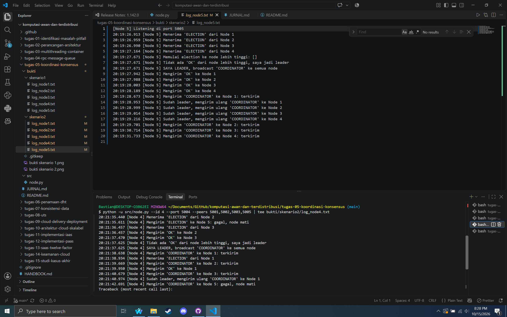

# Tugas 5 (Pekan 5) — Koordinasi & Konsensus

**Materi terkait:** Physical/Logical Clock, Election Algorithm (Bully/Raft).

## Studi Kasus

Terjadi konflik urutan waktu pada pesanan FoodGo (dua server mencatat urutan pesanan berbeda karena jam tidak sinkron), dan sistem membutuhkan satu **"Node Leader"** untuk mengelola antrean pesanan pusat agar tidak terjadi konflik pemrosesan ganda.

## Tugas Kelompok

Implementasikan simulasi **Bully Algorithm** untuk memilih leader di antara **5 node virtual** yang berjalan sebagai 5 proses Python terpisah di laptop yang sama (tiap node = satu proses di port berbeda, komunikasi lewat TCP socket di `localhost`).

Skeleton yang disediakan (`src/node.py`) sudah menangani bagian **infrastruktur jaringan** (membuka socket, menerima & mengirim pesan antar node) — bagian **algoritma Bully sendiri sengaja dikosongkan** (`# TODO`), karena itu inti pembelajaran tugas ini.

### Aturan Bully Algorithm yang harus diimplementasikan

1. Node yang mendeteksi leader tidak merespons (atau saat start pertama kali) mengirim pesan `ELECTION` ke semua node dengan ID **lebih besar** darinya.
2. Jika ada node ber-ID lebih besar yang merespons `OK`, node yang memulai election **berhenti mencalonkan diri** dan menunggu pesan `COORDINATOR`.
3. Jika **tidak ada** node ber-ID lebih besar yang merespons dalam batas waktu tertentu, node tersebut menjadi leader dan mem-broadcast `COORDINATOR` ke semua node lain.
4. Semua node mencatat siapa leader saat ini.

### Cara Menjalankan

Buka 5 terminal terpisah (satu per node):
```bash
python3 src/node.py --id 1 --port 5001 --peers 5002,5003,5004,5005
python3 src/node.py --id 2 --port 5002 --peers 5001,5003,5004,5005
python3 src/node.py --id 3 --port 5003 --peers 5001,5002,5004,5005
python3 src/node.py --id 4 --port 5004 --peers 5001,5002,5003,5005
python3 src/node.py --id 5 --port 5005 --peers 5001,5002,5003,5004
```

### Skenario Wajib Diuji & Dicatat

1. **Start normal**: nyalakan node 1–5 hampir bersamaan, catat siapa yang terpilih jadi leader (harusnya node ber-ID tertinggi, yaitu node 5).
2. **Leader mati**: matikan (Ctrl+C) proses node leader (node 5), amati node lain mendeteksi leader hilang dan memicu election baru. Catat leader baru yang terpilih (harusnya node 4).
3. Simpan log terminal (screenshot atau `> log_nodeX.txt` redirect) dari kedua skenario ke folder `bukti/`.

## Struktur Submission

```
tugas-05-koordinasi-konsensus/
├── README.md      # Analisis: kenapa perlu leader, kenapa Bully (vs Raft), hasil 2 skenario
├── JURNAL.md
├── src/
│   └── node.py
└── bukti/          # Log/screenshot skenario start normal & leader mati
```

## Rubrik Penilaian (Tugas 5)

| Komponen | Bobot | Kriteria |
|---|---|---|
| Implementasi Bully Algorithm benar | 35% | Election, OK, COORDINATOR message bekerja sesuai aturan algoritma |
| Bukti skenario leader mati → re-election | 30% | Log jelas menunjukkan leader baru terpilih otomatis |
| Analisis (kenapa perlu leader, trade-off Bully vs Raft) | 20% | Dikaitkan ke masalah urutan pesanan di skenario FoodGo |
| Proses & kontribusi kelompok | 15% | `JURNAL.md`, commit history |

## Batasan Penggunaan AI (Level 2)

Kebijakan **Level 2 (AI Assisted Idea Generation & Structuring)** berlaku — lihat [`../RUBRIK-UMUM.md`](../RUBRIK-UMUM.md). Boleh bertanya ke AI tentang gambaran umum algoritma election; **tidak boleh** meminta AI menuliskan isi `# TODO` di `src/node.py` (logika `on_message`, `start_election`, `declare_leader`, `monitor_leader`). Catat pemakaian AI di "Log Penggunaan AI" pada `JURNAL.md`.

- `README.md` wajib menjelaskan kenapa Bully Algorithm selalu memilih node ber-ID tertinggi yang masih hidup, dan apa kelemahannya dibanding algoritma lain (mis. jumlah pesan yang dikirim saat election, single point of failure sebelum leader baru terpilih) — bukan sekadar definisi generik.

---

# Laporan Analisis & Pembagian Tugas Kelompok

## Bagian 1: Kenapa FoodGo Perlu Leader 
*Duarte Sebastian N (103072400152)*
Masalah di studi kasus bukan sekadar "jam server salah". Masalahnya, **dua server sama-sama berhak memberi urutan** pada pesanan. Server A mencatat pesanan X lebih dulu, server B mencatat pesanan Y lebih dulu, dan tidak ada pihak yang berwenang memutuskan mana yang benar. Akibatnya bisa berupa:
 
- **Pemrosesan ganda**: dua server sama-sama mengambil pesanan yang sama dari antreannya masing-masing, sehingga satu pesanan dimasak atau dikirim dua kali.
- **Stok tidak konsisten**: pada menu sisa 1 porsi, kedua server sama-sama menganggap pelanggannya yang pertama, sehingga stok menjadi minus.
- **Urutan berbeda di tiap server**: laporan, nomor antrean, dan status pesanan tidak bisa dicocokkan.
Leader menghilangkan sumber konflik itu dengan satu aturan sederhana: **hanya leader yang boleh memberi nomor urut pesanan**. Server lain meneruskan pesanan ke leader, leader menaruhnya di satu antrean pusat (FIFO), lalu memberi nomor 1, 2, 3, dan seterusnya. Karena hanya ada satu pemberi nomor, urutan tidak lagi bergantung pada jam fisik masing-masing server. Bagian 2 menjelaskan kenapa sinkronisasi jam saja tidak cukup dan kenapa pendekatan ini lebih ringan dibanding totally ordered multicast.
 
Konsekuensinya, leader menjadi **titik tunggal**. Kalau leader mati, tidak ada yang boleh memberi nomor urut sampai leader baru terpilih. Karena itu FoodGo butuh mekanisme pemilihan ulang otomatis, dan tugas ini memakai Bully Algorithm. Bagian 3 membahas kenapa Bully selalu memilih ID tertinggi beserta harga yang harus dibayar.

---

## Bagian 2: Akar Masalah — Jam Fisik, Logical Clock, dan Urutan Pesanan
*Penulis: Muhammad Chaesar Pratama (103072400119)*

### 1. Masalah Jam Fisik pada Server FoodGo (Clock Drift, Presisi, dan Akurasi)
- **Clock Drift**: Jam perangkat keras di setiap server digerakkan oleh kristal kuarsa yang dipengaruhi suhu dan tegangan listrik. Akibatnya, jam Server 1 dan Server 2 tidak berdetik dengan kecepatan yang persis sama dan mengalami pergeseran waktu (*clock drift* dengan laju batas `rho`).
- **Precision (pi) vs Accuracy (alpha)**: 
  - *Precision (pi)*: Deviasi waktu antar server di dalam sistem cluster (`|C_i - C_j| <= pi`).
  - *Accuracy (alpha)*: Deviasi waktu jam server terhadap standar waktu luar/UTC (`|C_i - UTC| <= alpha`).
- **Dampak pada FoodGo**: Jika dua pelanggan memesan menu yang sama di server berbeda dalam waktu yang berdekatan, perbedaan jam fisik antar server dapat memicu kesalahan stempel waktu (*timestamp*), sehingga urutan pemrosesan pesanan menjadi tertukar.

### 2. Kenapa Sinkronisasi Jam Fisik Saja Tidak Cukup
- Protokol sinkronisasi jam fisik (seperti NTP) memiliki keterbatasan latensi jaringan (*jitter* dan asimetri transmisi), sehingga selalu ada margin kesalahan waktu.
- **Poin Kunci (Slide 7)**: Dalam sistem terdistribusi, kebutuhan utama bukanlah mengetahui jam fisik persis (*wall-clock time*), melainkan **kesepakatan urutan kejadian (*agreement on event ordering*)**. Mengetahui apakah Pesanan A masuk *sebelum* Pesanan B jauh lebih penting daripada jam absolutnya.

### 3. Solusi Lamport Logical Clock & Relasi Happened-Before
- Leslie Lamport (1978) memperkenalkan relasi **happened-before** (`->`):
  1. Jika event `a` terjadi sebelum `b` pada proses yang sama, maka `a -> b`.
  2. Jika `a` adalah event pengiriman pesan dan `b` adalah penerimaan pesan tersebut, maka `a -> b`.
  3. Bersifat transitif: jika `a -> b` dan `b -> c`, maka `a -> c`.
- **Aturan Pembaruan Clock**:
  - Setiap event lokal: jam lokal bertambah `C_i = C_i + 1`.
  - Saat kirim pesan: sertakan nilai `C_i`.
  - Saat terima pesan: perbarui jam lokal `C_j = max(C_j, C_msg) + 1`.
  - Jika timestamp sama, Process ID digunakan sebagai penentu urutan (*tie-breaker*).

### 4. Totally Ordered Multicast & Analogi Pesanan FoodGo
- **Konsep**: Seluruh server mengeksekusi urutan transaksi yang identik dengan mem-broadcast pesan ber-timestamp Lamport dan menempatkannya di antrean lokal. Transaksi hanya dieksekusi jika berada di urutan terdepan dan semua server telah membalas ACK.
- **Analogi FoodGo**: Pada promo *flash sale* menu sisa 1 porsi, Pelanggan X checkout di Server 1 dan Pelanggan Y checkout di Server 2. Totally ordered multicast memastikan seluruh server memproses dalam urutan yang sama, sehingga tidak terjadi *double booking* atau stok minus.

### 5. Batasan Lamport Clock & Solusi Vector Clock
- **Kelemahan Lamport**: Hubungannya bersifat satu arah (`a -> b` maka `C(a) < C(b)`). Jika `C(a) < C(b)`, kita tidak bisa memastikan apakah `a` menyebabkan `b`, karena bisa saja kedua event terjadi bersamaan secara independen (*concurrent*).
- **Vector Clock**: Setiap server memelihara vektor integer `V_i[1..N]`. Dengan vektor ini, sistem dapat membuktikan kausalitas dua arah (`a -> b <=> V(a) < V(b)`) dan mendeteksi secara akurat jika ada konflik pemesanan yang bersifat konkruen.

### 6. Alasan Memilih Koordinator/Leader dibanding Logical Clock di Semua Node
- **Overhead Jaringan Ringan**: Totally ordered multicast membutuhkan broadcast ke seluruh server dan pengumpulan ACK (`O(N^2)` pesan per transaksi). Dengan adanya Leader, worker cukup berkomunikasi langsung ke Leader (`O(1)` pesan).
- **Antrean Terpusat FIFO**: Leader bertindak sebagai *single source of truth* untuk nomor urut pesanan tanpa perlu logika antrean terdistribusi yang rumit di tiap node.
- **Toleransi Kegagalan Otomatis**: Risiko *single point of failure* (SPOF) diselesaikan dengan **Bully Algorithm**. Jika node leader mati, node-node aktif secara otomatis memilih leader baru (ID tertinggi yang hidup) dan sistem segera pulih.

---

## Bagian 3: Kenapa Bully Selalu Memilih ID Tertinggi + Kelemahannya
*Duarte Sebastian N (103072400152)*

### 1. Kenapa yang menang selalu ID tertinggi yang masih hidup
 
Ada dua aturan di `node.py` yang membuat hasilnya pasti:
 
1. **Node hanya boleh menyatakan diri leader kalau tidak ada satu pun node lebih tinggi yang membalas `OK`** (`start_election`). Selama masih ada node lebih tinggi yang hidup, node itu pasti membalas `OK` dan menjalankan election-nya sendiri (`on_message`, cabang `ELECTION`).
2. **`COORDINATOR` dari node yang ID-nya lebih rendah ditolak**, lalu penerimanya memulai election sendiri (`on_message`, cabang `COORDINATOR`).
Dari aturan 1, election "naik" dari node rendah ke node tinggi. Setiap node yang masih punya atasan hidup akan mundur. Rantai ini baru berhenti di node yang tidak punya atasan hidup, yaitu node ber-ID tertinggi yang masih hidup. Hanya node itu yang lolos dari timeout tanpa `OK`, jadi hanya node itu yang berhak broadcast `COORDINATOR`.
 
Aturan 2 menangani kasus ketika node rendah **sempat** menang karena node lebih tinggi belum menyala. Kasus ini benar-benar terjadi di skenario 1 kami. Node 1 menyala paling awal, semua `ELECTION`-nya gagal, lalu ia menyatakan diri leader pada `20:11:03.230`. `COORDINATOR` dari Node 1 kemudian ditolak oleh Node 2, 3, 4, dan 5 ("Menolak 'COORDINATOR' dari Node 1 (ID lebih rendah)"). Node 5 lalu mengulang deklarasi dan menjadi leader akhir. Inilah arti nama "bully": node yang lebih besar selalu mengambil alih.
 
### 2. Kelemahan Bully, dibuktikan dari log kami
 
**a. Jumlah pesan banyak, O(N²).** Kalau semua node yang tersisa ikut mendeteksi kematian leader, setiap node `i` mengirim `ELECTION` ke semua node di atasnya, dan setiap node membalas `OK` ke semua node di bawahnya. Untuk skenario 2 (Node 1–4 hidup, Node 5 mati):
 
| Pesan | Rumus | Prediksi | Hasil log kami |
|---|---|---|---|
| `ELECTION` | 4 + 3 + 2 + 1 | 10 | 6 terkirim + 4 gagal (ke Node 5 yang mati) = **10** |
| `OK` | 0 + 1 + 2 + 3 | 6 | **6** |
| `COORDINATOR` | N − 1 | 4 | 3 terkirim + 1 gagal = **4**, ditambah 1 kirim ulang ke Node 1 |
| **Total** | | **20** | **21** |
 
Angka log cocok persis dengan kasus terburuk, karena keempat node mendeteksi kematian Node 5 hampir bersamaan (lihat Bagian 5). Padahal hanya satu pesan yang benar-benar dibutuhkan, yaitu "Node 4 adalah leader". Sisanya overhead koordinasi. Dengan 5 node angka ini masih kecil, tetapi jumlahnya tumbuh kuadratik: untuk 50 server FoodGo, kasus terburuknya sudah ribuan pesan dalam satu kali election.
 
**b. Ada jeda tanpa leader.** Selama election berlangsung, tidak ada yang boleh memberi nomor urut pesanan. Di skenario 2 kami, jeda itu terdiri dari:
- 0–3 detik sampai kematian terdeteksi (interval `monitor_leader`)
- sekitar 4,2 detik dari deteksi pertama sampai Node 4 menyatakan diri leader
- sekitar 7,3 detik dari deteksi pertama sampai semua node tahu leader baru
Bagi FoodGo, pesanan yang masuk selama jeda ini harus ditahan atau ditolak. Kalau server diam-diam tetap memberi nomor sendiri, konflik urutan dari studi kasus muncul lagi.
 
**c. Leader dipilih berdasarkan ID, bukan berdasarkan data terbaru.** Node 4 menang hanya karena ID-nya 4. Bully tidak memeriksa apakah antrean pesanan Node 4 sudah sama dengan antrean terakhir milik Node 5. Kalau Node 5 sudah memberi nomor ke pesanan yang belum tersalin ke Node 4, pesanan itu bisa hilang atau bernomor ganda setelah pergantian leader. ZooKeeper dan Raft menangani ini (Bagian 4).
 
**d. Deteksi kegagalan hanya berdasarkan timeout.** Node dianggap mati kalau `PING` atau `ELECTION` tidak tersambung. Node yang hanya lambat, atau terputus sebagian jaringannya, akan dianggap mati. Ada dua akibatnya:
- **Split-brain**: kalau jaringan terbelah, setiap kelompok memilih leader sendiri, sehingga ada dua antrean FoodGo yang memberi nomor bersamaan.
- **Leader berganti-ganti**: kalau Node 5 hidup lagi, ia langsung mem-bully Node 4 dan memicu election baru, padahal Node 4 baik-baik saja.
**e. Leader sementara yang salah saat start.** Skenario 1 memperlihatkan Node 1 sempat menjadi leader beberapa detik sebelum di-bully Node 5. Di sistem nyata, setiap pergantian seperti ini adalah satu kali jeda tambahan tanpa leader yang stabil.
 
### 3. Kenapa tetap memakai Bully di tugas ini
 
Bully sederhana, tidak butuh mayoritas suara, dan cocok untuk lingkungan simulasi yang tertutup (5 proses di satu laptop, tanpa partisi jaringan). Untuk FoodGo di produksi, kelemahan c dan d berbahaya karena menyangkut data pesanan. Pilihan yang lebih aman adalah Raft atau ZooKeeper, sesuai perbandingan di Bagian 4.

---

## Bagian 4: Perbandingan Bully vs Ring, ZooKeeper, Raft
*(Didit Septa Putra)*

### 1. Perbandingan Bully vs Ring
- **Bully**: Node yang mendeteksi leader mati mengirim ELECTION ke semua node ber-ID lebih besar. Jika tidak ada OK, node itu menjadi leader. Pesannya bisa banyak: sampai 24 untuk 5 node (O(N^2)), tetapi pulihnya cepat.
- **Ring**: ELECTION dikirim berantai ke tetangga sampai satu putaran penuh. Pesannya lebih sedikit, sekitar 10 untuk 5 node (O(N)), tetapi lebih lambat karena berurutan.
- **Di FoodGo**: Selama belum ada leader, pesanan baru tidak punya nomor urut. Bully lebih singkat jedanya, Ring lebih hemat pesan. Keduanya memilih leader berdasarkan ID, bukan berdasarkan antrean terbaru.

### 2. Bully vs ZooKeeper
- **Bully**: Leader dipilih dari ID tertinggi. Node 4 bisa jadi leader walau tidak punya antrean terbaru dari node 5, sehingga pesanan yang sudah bernomor bisa hilang.
- **ZooKeeper**: Leader dipilih dari transaksi terbaru (zxid), jadi antrean tidak mundur setelah leader mati.
- **Di FoodGo**: ZooKeeper lebih aman untuk data pesanan, tetapi lebih rumit karena butuh ensemble dan kuorum.

### 3. Bully vs Raft
- **Bully**: Node menjadi leader sendiri tanpa voting dan tanpa term. Jika jaringan terpecah, dua kelompok bisa punya leader masing-masing.
- **Raft**: Leader harus dipilih suara mayoritas, punya term, dan timeout acak. Pesanan baru dianggap sah setelah disalin ke mayoritas node.
- **Di FoodGo**: Raft mencegah dua antrean berjalan bersamaan dan pesanan yang sudah dikonfirmasi tidak hilang, tetapi implementasinya lebih rumit.

### 4. Tabel Perbandingan Bully vs Ring, ZooKeeper, Raft

| Aspek | Bully | Ring | ZooKeeper | Raft |
|---|---|---|---|---|
| Dasar pemilihan leader | ID tertinggi yang hidup | ID tertinggi di daftar node hidup | Transaksi terbaru (`zxid`) | Suara mayoritas |
| Pesan yang dikirim | `ELECTION`, `OK`, `COORDINATOR` | `ELECTION` berantai, lalu pengumuman | Bergantung protokol ensemble | `REQUEST_VOTE`, `VOTE`, heartbeat |
| Jumlah pesan (5 node) | Hingga 24 (`O(N^2)`) | Sekitar 10 (`O(N)`) | Bergantung protokol | `O(N)` per putaran |
| Kecepatan election | Cepat | Lebih lambat (berurutan) | Cepat setelah ensemble sepakat | Cepat (timeout acak) |
| Antrean pesanan FoodGo aman? | Tidak | Tidak | Ya | Ya |
| Risiko dua leader (split-brain) | Ada | Ada | Tidak | Tidak |
| Kerumitan implementasi | Rendah | Rendah–sedang | Tinggi | Sedang–tinggi |

## Bagian 5: Hasil Skenario Start Normal & Leader Mati + Observasi
*(Alif Rifqi Pratama)*

### Ringkasan implementasi yang diuji
 
| Aturan Bully | Di `src/node.py` |
|---|---|
| 1. Kirim `ELECTION` ke node ber-ID lebih besar | `start_election()` mengirim ke semua `pid > node_id` |
| 2. Ada `OK` → berhenti, tunggu `COORDINATOR` | `received_ok` (Event); tunggu `coordinator_received` maks. 4 detik, lalu ulang election kalau tidak datang |
| 3. Tidak ada `OK` dalam 2 detik → jadi leader | `ELECTION_TIMEOUT = 2.0` → `declare_leader()` broadcast `COORDINATOR` |
| 4. Semua node mencatat leader | Handler `COORDINATOR` menyimpan `leader_id`; `COORDINATOR` dari ID lebih rendah ditolak |
| Deteksi leader mati | `monitor_leader()` mengirim `PING` ke leader setiap 3 detik |
 
Setiap baris log diberi timestamp `HH:MM:SS.mmm` supaya durasi bisa diukur.
 
### 1. Skenario 1: Start Normal
 
**Bukti:** `bukti/skenario1/log_node1..5.txt`, `bukti/skenario1/bukti_skenario1.png`


 
**Hasil: leader akhir adalah Node 5**, dan kelima node sepakat.
 
| Node | Catatan terakhir |
|---|---|
| 5 | `SAYA LEADER` (20:11:02.601, diulang 20:11:07.308) |
| 1 | 20:11:08.320 `Leader terpilih: Node 5` |
| 2 | 20:11:09.322 `Leader terpilih: Node 5` |
| 3 | 20:11:10.350 `Leader terpilih: Node 5` |
| 4 | 20:11:11.380 `Leader terpilih: Node 5` |
 
**Kronologi:**
1. Kelima node dinyalakan berjeda sekitar 2 detik (Node 1 pukul 20:10:53, Node 5 sekitar 20:11:01). Jadi start-nya tidak benar-benar bersamaan.
2. Node 1 mengirim `ELECTION` ke Node 2–5 saat node-node itu belum hidup, sehingga semuanya gagal. Setelah timeout, Node 1 menyatakan diri leader (20:11:03.230).
3. Sementara itu, election dari Node 2, 3, dan 4 sudah naik sampai Node 5. Node 5 menjadi leader pada 20:11:02.601.
4. `COORDINATOR` dari Node 1 **ditolak** oleh Node 2 (04.235), Node 3 (05.263), Node 4 (06.280), dan Node 5 (07.308), karena ID Node 1 lebih rendah.
5. Node 5 mengulang deklarasi leader, dan semua node mencatat Node 5 paling lambat pukul 20:11:11.380.

Sebagai pembanding, bagian awal log `bukti/skenario2/` (20:19:21–20:19:31) adalah start yang lebih rapat. Di run itu tidak ada node rendah yang sempat menjadi leader: Node 5 langsung menang (20:19:27.671), dan Node 1–4 mencatatnya antara 20:19:28.673 dan 20:19:29.216.
 
### 2. Skenario 2: Leader Mati
 
**Bukti:** `bukti/skenario2/log_node1..5.txt`, [bukti_skenario2-terminal_node4.png](bukti/bukti_skenario2-terminal_node4.png) (Node 4 menjadi leader), [bukti_skenario2-terminal_node5.png](bukti/bukti_skenario2-terminal_node5.png) (Node 5 dimatikan dengan Ctrl+C)


 

 
**Hasil: Node 4 terpilih otomatis sebagai leader baru.**
 
| Node | Deteksi Node 5 mati | Catatan leader baru |
|---|---|---|
| 2 | 20:21:33.417 (pertama) | 20:21:39.669 `Leader terpilih: Node 4` |
| 4 | 20:21:33.593 | 20:21:37.625 `SAYA LEADER` |
| 1 | 20:21:35.878 | 20:21:38.638 `Leader terpilih: Node 4` |
| 3 | 20:21:35.970 (sudah ikut election sejak 35.440 karena `ELECTION` dari Node 2) | 20:21:40.679 `Leader terpilih: Node 4` |
 
**Waktu kill.** Node 5 dimatikan dengan Ctrl+C sesaat sebelum 20:21:33.417 (deteksi pertama). Perintah `date` di terminal Node 5 mencatat 20:21:35.005, tetapi jam itu terlambat karena baru diketik setelah Ctrl+C. Karena itu deteksi pertama kami pakai sebagai titik acuan. Log Node 5 berhenti di 20:19:31 karena traceback `KeyboardInterrupt` tidak ikut tersimpan oleh `tee`; matinya Node 5 terlihat di [bukti_skenario2-terminal_node5.png](bukti/bukti_skenario2-terminal_node5.png).
 
**Durasi tanpa leader:**
- deteksi pertama → Node 4 menyatakan diri leader: **≈ 4,2 detik**
- deteksi pertama → semua node mencatat Node 4: **≈ 7,3 detik**
- ditambah 0–3 detik antara kill dan deteksi (interval monitor), yang tidak terukur dari log
**Jumlah pesan setelah Node 5 mati:**
 
| Pesan | Terkirim | Gagal (ke Node 5) |
|---|---|---|
| `ELECTION` | 6 | 4 |
| `OK` | 6 | – |
| `COORDINATOR` | 4 (3 broadcast + 1 kirim ulang ke Node 1) | 1 |
| **Total** | **16** | **5** |
 
### 3. Observasi
 
1. **Election serentak.** Keempat node mendeteksi kematian Node 5 dalam rentang sekitar 2,5 detik dan semuanya menjalankan election. Karena itu jumlah pesan sama persis dengan prediksi kasus terburuk Bully (Bagian 3).
2. **Node 4 menang lewat timeout.** Node 4 mendeteksi sendiri (33.593), mengirim `ELECTION` ke Node 5 dan gagal (35.611), lalu menunggu 2 detik tanpa `OK` dan menyatakan diri leader (37.625). Rantai waktunya: deteksi + 2 detik koneksi gagal + 2 detik timeout.
3. **Pesan yang terlambat.** Node 1 sudah menerima `COORDINATOR` dari Node 4 (38.638) tetapi masih menyelesaikan pengiriman `ELECTION`-nya. Node 4 membalas dengan `OK` lalu mengirim ulang `COORDINATOR` (40.974). Pesan ini sebenarnya tidak perlu dan menjadi contoh overhead Bully.
4. **Koneksi lambat di Windows.** Di laptop kami, setiap koneksi TCP ke node hidup butuh sekitar 1 detik, dan ke node mati sekitar 2 detik. Dugaan kami, `localhost` di Windows dicoba lewat IPv6 (`::1`) dulu sebelum jatuh ke IPv4. Kami tidak mengubahnya karena berada di bagian infrastruktur skeleton. Efek inilah yang membuat broadcast `COORDINATOR` Node 4 butuh sekitar 3 detik untuk sampai ke Node 3 dan memperpanjang downtime.
5. **Penolakan `COORDINATOR` bekerja.** Di skenario 1, node yang lebih tinggi tidak lagi tunduk pada Node 1. Ini berbeda dengan run sebelum perbaikan, ketika Node 5 sempat mencatat Node 2 sebagai leader (lihat `JURNAL.md`).

---

## Bagian 6: Tabel Kontribusi

| Nama | NIM | Kontribusi |
|---|---|---|
| Muhammad Chaesar Pratama | 103072400119 | Implementasi TODO 1 (`on_message`), desain state bersama (`received_ok`, `is_electing`), dan analisis Bagian 2 (Jam Fisik, Logical Clock, dan Urutan Pesanan) |
| Didit Septa Putra | 103072400071 | Implementasi TODO 2 & 3 (`start_election`, `declare_leader`), analisis Bagian 4 (Bully vs Ring, ZooKeeper, Raft)|
| Alif Rifqi Pratama | 103072400133 | Implementasi TODO 4 (`monitor_leader`), pengujian skenario 1 & 2, dokumentasi bukti |
| Duarte Sebastian Napitupulu | 103072400152 | Integrasi kode, analisis Bagian 1 & 3, rekap JURNAL, submission |
