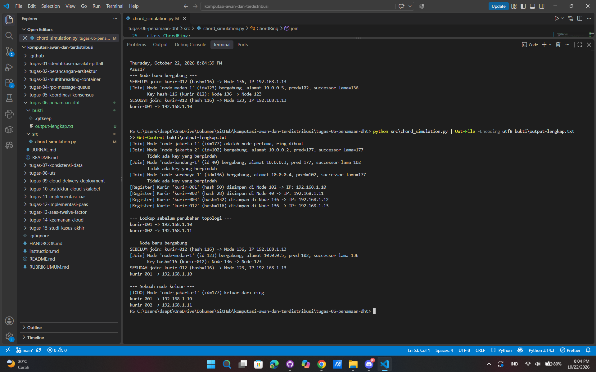
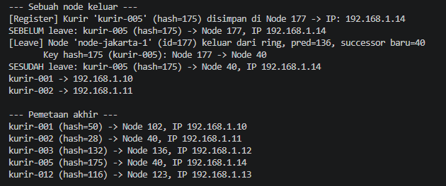

# Jurnal Proses — Tugas 6

## Implementasi find_successor
- Kesalahan pertama yang ditemui (mis. lupa wrap-around di ring):
  1. Lupa wrap-around: kalau hash kurir lebih besar dari semua ID node (misal hash 200), fungsi loop sampai habis dan mengembalikan None. Padahal di ring melingkar seharusnya balik ke node pertama.
  2. Urutan dict: dict di Python urutannya sesuai urutan input, bukan angka numerik. Kalau langsung di-loop tanpa disortir, pencarian successor jadi salah.
  3. Operator perbandingan: harus `>=` bukan `>`, supaya kalau hash kurir sama persis dengan ID node, node itu sendiri yang ambil alih.
  4. Ring kosong: waktu awal sebelum ada node yang join, fungsi harus return None supaya join pertama tidak error.
- Cara memperbaikinya:
  1. Tambah `if not self.nodes: return None` di awal fungsi.
  2. Urutkan key node dengan `sorted(self.nodes.keys())`.
  3. Cek dengan kondisi `if node_id >= key_hash: return node_id`.
  4. Tambah `return sorted_nodes[0]` di akhir fungsi untuk menangani wrap-around.
---

## Skenario join/leave
- Hasil sebelum & sesudah node baru bergabung: `node-medan-1` (id 123) masuk di antara Node 102 dan Node 136. Hanya `kurir-012` (hash 116) yang berpindah, dari Node 136 ke Node 123. Kurir lain tetap, dan IP `kurir-012` tetap 192.168.1.13. Detail di bagian *Skenario join* di bawah.
- Hasil sebelum & sesudah node keluar: `node-jakarta-1` (id 177) keluar. Hanya `kurir-005` (hash 175) yang berpindah, dari Node 177 ke Node 40 (wrap-around, karena tidak ada node tersisa dengan ID ≥ 175). Kurir lain tetap, dan IP `kurir-005` tetap 192.168.1.14. Detail di bagian *Skenario leave* di bawah.

## Skenario join — sebelum dan sesudah node baru bergabung
 
### Skenario
 
Empat node awal (`node-jakarta-1`, `node-jakarta-2`, `node-bandung-1`, `node-surabaya-1`) sudah ada di ring, lalu empat kurir didaftarkan. Setelah itu `node-medan-1` bergabung.
 
Posisi node di ring (urut dari kecil ke besar):
 
| Node | Hash (ID) |
|---|---|
| node-bandung-1 | 40 |
| node-jakarta-2 | 102 |
| **node-medan-1 (baru)** | **123** |
| node-surabaya-1 | 136 |
| node-jakarta-1 | 177 |
 
### Tabel sebelum dan sesudah join
 
| Kurir | Hash | Sebelum join node-medan-1 | Sesudah join node-medan-1 |
|---|---|---|---|
| kurir-012 | 116 | Node 136 | **Node 123** |
| kurir-003 | 132 | Node 136 | Node 136 (tidak berubah) |
| kurir-001 | 50 | Node 102 | Node 102 (tidak berubah) |
| kurir-002 | 28 | Node 40 | Node 40 (tidak berubah) |

### Bukti
 
- 
- Log lengkap: `bukti/output-lengkap.txt`

### Penjelasan
Node node-medan-1 memiliki hash 123, sehingga posisinya berada di antara Node 102 (predecessor) dan Node 136 (successor lama). Sebelum node ini bergabung, semua key dengan hash di atas 102 sampai 136 dipegang oleh Node 136. Setelah bergabung, key dengan hash di atas 102 sampai 123 diambil alih oleh Node 123. Dampaknya pada tiap kurir terlihat pada tabel di atas:

- kurir-012 (hash 116) berada di antara 102 dan 123, sehingga tanggung jawabnya berpindah dari Node 136 ke Node 123. Ini satu-satunya perubahan pada tabel.
- kurir-003 (hash 132) lebih besar dari 123, jadi node pertama yang ID-nya sama atau lebih besar tetap Node 136. Kurir ini tidak berpindah.
- kurir-001 (hash 50) dan kurir-002 (hash 28) lebih kecil dari 102, sehingga tetap di Node 102 dan Node 40. Keduanya tidak terpengaruh.

Alamat IP kurir-012 tetap 192.168.1.13; yang berubah hanya node penanggung jawabnya, sehingga lookup() tetap berhasil. Hasil ini sesuai dengan prinsip Chord bahwa saat sebuah node bergabung, hanya key di antara predecessor dan node baru itu yang berpindah, sedangkan key lainnya tetap.

---

## Skenario leave — sebelum dan sesudah node keluar
 
### Masalah yang ditemukan sebelum implementasi
Rencana awal adalah mengeluarkan `node-jakarta-1` (id 177). Node ini memegang rentang `(136, 177]`, tetapi tidak ada kurir awal yang hash-nya jatuh di rentang itu (hash yang ada: 28, 50, 116, 132). Artinya, walaupun `leave()` sudah benar, output-nya hanya "tidak ada key yang berpindah" dan tidak membuktikan apa-apa.
 
Solusinya, kami menghitung hash beberapa ID kurir tambahan dan memilih `kurir-005` (hash **175**) yang jatuh di rentang Node 177. Kandidat lain yang juga cocok: `kurir-009` (170) dan `kurir-019` (163). Kurir ini didaftarkan tepat sebelum skenario leave supaya bagian join di output tetap sama dengan bukti join.
 
### Implementasi leave()
1. Validasi: kalau node tidak ada di ring, leave dibatalkan; kalau node terakhir, ring dikosongkan.
2. Hitung predecessor node yang akan keluar, lalu kumpulkan key di rentang `(pred, node_id]` memakai `in_range()`. Langkah ini harus dilakukan **sebelum** node dihapus.
3. `del self.nodes[node_id]` (TODO 4).
4. Panggil `find_successor(node_id)` **sesudah** node dihapus untuk mendapat successor baru (TODO 5). Karena node-nya sudah tidak ada, fungsi otomatis lompat ke node berikutnya, termasuk wrap-around.
Kesalahan yang sempat terpikir: kalau `find_successor(node_id)` dipanggil sebelum `del`, hasilnya node itu sendiri (177), bukan successor baru.
 
### Tabel sebelum dan sesudah leave
 
| Kurir | Hash | Sebelum leave node-jakarta-1 | Sesudah leave node-jakarta-1 |
|---|---|---|---|
| kurir-005 | 175 | Node 177 | **Node 40** (wrap-around) |
| kurir-003 | 132 | Node 136 | Node 136 (tidak berubah) |
| kurir-012 | 116 | Node 123 | Node 123 (tidak berubah) |
| kurir-001 | 50 | Node 102 | Node 102 (tidak berubah) |
| kurir-002 | 28 | Node 40 | Node 40 (tidak berubah) |
 
### Bukti
 
- 
- Log lengkap: [`bukti/output-lengkap-leave.txt`](bukti/output_lengkap_leave.txt)

### Penjelasan
Setelah Node 177 keluar, ring tersisa `[40, 102, 123, 136]`. Tidak ada node dengan ID ≥ 175, sehingga successor untuk key 175 wrap-around ke node terkecil, yaitu Node 40. Rentang Node 40 melebar dari `(177, 40]` menjadi `(136, 40]`. IP kurir-005 tetap 192.168.1.14 dan `lookup()` tetap berhasil. Kurir lain tidak berpindah karena hash-nya tidak berada di rentang node yang keluar.
 
---

## Implementasi find_successor
- Kesalahan pertama yang ditemui (mis. lupa wrap-around di ring):
  1. Lupa wrap-around: kalau hash kurir lebih besar dari semua ID node (misal hash 200), fungsi loop sampai habis dan mengembalikan None. Padahal di ring melingkar seharusnya balik ke node pertama.
  2. Urutan dict: dict di Python urutannya sesuai urutan input, bukan angka numerik. Kalau langsung di-loop tanpa disortir, pencarian successor jadi salah.
  3. Operator perbandingan: harus `>=` bukan `>`, supaya kalau hash kurir sama persis dengan ID node, node itu sendiri yang ambil alih.
  4. Ring kosong: waktu awal sebelum ada node yang join, fungsi harus return None supaya join pertama tidak error.

- Cara memperbaikinya:
  1. Tambah `if not self.nodes: return None` di awal fungsi.
  2. Urutkan key node dengan `sorted(self.nodes.keys())`.
  3. Cek dengan kondisi `if node_id >= key_hash: return node_id`.
  4. Tambah `return sorted_nodes[0]` di akhir fungsi untuk menangani wrap-around.

## Log Penggunaan AI (Level 2)

> Wajib diisi sesuai kebijakan Level 2 di [`../RUBRIK-UMUM.md`](../RUBRIK-UMUM.md). Tulis "Tidak memakai AI" pada baris pertama jika memang tidak dipakai. Hanya untuk brainstorming ide/outline — bukan untuk kode/analisis/teks akhir.

| Tanggal | Tool AI | Prompt yang diberikan | Ringkasan saran/ide AI | Bagaimana diolah jadi tulisan/kode sendiri |
|---|---|---|---|---|
| 22/10/2026 | Gemini | Diskusi logika find_successor Chord, aturan wrap-around, penanganan ring kosong, dan contoh penelusuran manual hash SHA-1 | Penjelasan konsep successor (node terkecil yang >= key), wrap-around ke node pertama, dan contoh hitungan hash mod 256 | Diimplementasikan ke find_successor, register_kurir, dan lookup di chord_simulation.py, serta ditulis ke bagian penelusuran manual README |
| 225/10/2026 | Claude | Tolong jelasin singkat dan mudah dimengerti dalam satu paragraf apa itu DHT/Chord dong! | DHT (Distributed Hash Table) adalah cara menyimpan dan mencari data berbentuk pasangan key–value yang tersebar di banyak komputer (node) tanpa server pusat. Chord adalah salah satu algoritma DHT yang paling terkenal. | Dimasukkan ke analisis 1 di README |
