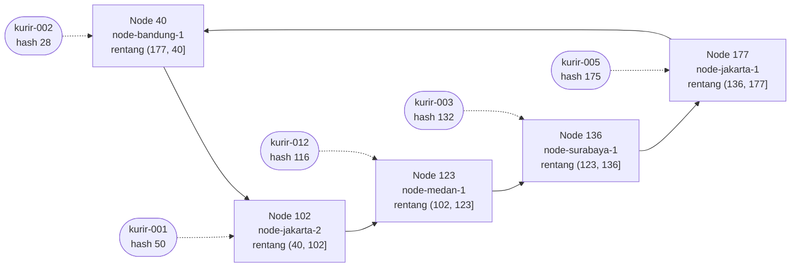

# Tugas 6 (Pekan 6) — Penamaan & Resolusi Lokasi

**Materi terkait:** Flat Naming, Structured Naming (DNS), Distributed Hash Table (DHT)/Chord.

## Studi Kasus

Pelanggan FoodGo kesulitan menemukan alamat IP server kurir yang **dinamis** (kurir berpindah lokasi/jaringan, IP-nya sering berubah). FoodGo butuh cara memetakan **ID Kurir** (identitas tetap) ke **alamat IP terkininya** tanpa server pusat tunggal yang jadi bottleneck/single point of failure.

## Tugas Kelompok

Implementasikan **simulasi Chord DHT** sederhana (single-process, tidak perlu jaringan sungguhan — cukup simulasi struktur data & algoritma di satu program Python) yang memetakan ID Kurir ke alamat IP mereka.

Konsep yang harus terlihat jalan dalam simulasi kalian:
1. **Consistent hashing**: ID Kurir dan ID Node di-hash ke ruang angka yang sama (mis. 0–255 untuk kesederhanaan, `m=8` bit).
2. **Ring topology**: node-node diurutkan melingkar berdasarkan hasil hash-nya.
3. **Lookup**: fungsi `lookup(kurir_id)` yang menemukan node mana yang bertanggung jawab menyimpan mapping ID Kurir tersebut → alamat IP-nya (aturan Chord: node dengan ID hash **terkecil yang lebih besar atau sama dengan** hash key, disebut *successor*).
4. **Perubahan topologi**: simulasikan minimal satu node baru bergabung (`join`) atau satu node keluar (`leave`), tunjukkan bagaimana mapping berpindah tanggung jawab ke node lain.

Skeleton disediakan di `src/chord_simulation.py` dengan fungsi hashing dan struktur ring sudah ada — bagian `lookup()`, `join()`, dan `leave()` sengaja dikosongkan.

### Cara Menjalankan

```bash
python3 src/chord_simulation.py
```

## Tugas Analisis (`README.md`)

1. Jelaskan **kenapa DHT/Chord** lebih cocok untuk kasus ini dibanding **flat naming sederhana** (mis. tabel pusat ID→IP) atau **DNS konvensional** — kaitkan dengan sifat "IP kurir sering berubah" dan kebutuhan tanpa titik gagal tunggal.
2. Gambarkan (boleh pakai Mermaid, lihat Tugas 2) ring topology dari simulasi kalian, tandai node mana yang bertanggung jawab atas ID Kurir mana.
3. Jelaskan apa yang terjadi pada mapping saat sebuah node **keluar** dari ring (siapa yang mengambil alih tanggung jawabnya) — dukung dengan output program.

## Struktur Submission

```
tugas-06-penamaan-dht/
├── README.md      # Analisis + diagram ring
├── JURNAL.md
├── src/
│   └── chord_simulation.py
└── bukti/          # Output program (screenshot/log) untuk skenario join & leave
```

## Rubrik Penilaian (Tugas 6)

| Komponen | Bobot | Kriteria |
|---|---|---|
| Implementasi lookup/join/leave benar | 35% | Consistent hashing & successor lookup sesuai aturan Chord |
| Bukti perubahan topologi (join/leave) | 25% | Output menunjukkan mapping berpindah dengan benar |
| Analisis kenapa DHT vs flat naming/DNS | 25% | Argumen spesifik ke kasus IP kurir dinamis, bukan definisi umum |
| Proses & kontribusi kelompok | 15% | `JURNAL.md`, commit history |

## Batasan Penggunaan AI (Level 2)

Kebijakan **Level 2 (AI Assisted Idea Generation & Structuring)** berlaku — lihat [`../RUBRIK-UMUM.md`](../RUBRIK-UMUM.md). Boleh bertanya konsep umum consistent hashing/Chord ke AI; **tidak boleh** meminta AI menuliskan isi `# TODO` di `src/chord_simulation.py` (`find_successor`, `join`, `leave`, dst). Catat pemakaian AI di "Log Penggunaan AI" pada `JURNAL.md`.

- `README.md` wajib menelusuri manual (langkah demi langkah) bagaimana `lookup()` menemukan successor untuk salah satu ID Kurir contoh yang dipakai di `chord_simulation.py` — bukan cuma menempelkan output program.

## Kontribusi Kelompok
 
| Nama | NIM | Kontribusi |
|---|---|---|
| Muhammad Chaesar Pratama | 103072400119 | `find_successor()`, `register_kurir()`, `lookup()`, penelusuran manual `lookup()` |
| Didit Septa Putra | 103072400071 | `join()`, skenario & bukti join, jurnal join |
| Duarte Sebastian Napitupulu | 103072400152 | Analisis no. 1, diagram ring (no. 2), tabel kontribusi, `leave()`, skenario & bukti leave, analisis no. 3 |


## 1. Kenapa DHT/Chord, bukan tabel pusat atau DNS?
 
Inti masalah FoodGo ada dua: **IP kurir sering berubah** (pindah dari Wi-Fi ke seluler, ganti BTS, pindah kota), dan **tidak boleh ada satu server yang kalau mati membuat semua lookup gagal**.
 
**Tabel pusat ID → IP (flat naming sederhana).** Secara logika ini paling mudah: satu dictionary di satu server. Masalahnya justru ada di beban update. Kalau ada ribuan kurir aktif dan masing-masing mengirim update IP setiap kali jaringannya berganti, *semua* write dan *semua* lookup pelanggan masuk ke server yang sama. Server itu menjadi bottleneck pada jam makan siang, dan kalau server itu down, tidak ada satu pun pelanggan yang bisa menemukan kurirnya, walaupun kurir dan pelanggan sendiri baik-baik saja. Replikasi master–slave bisa membantu, tapi IP yang sering berubah berarti replika terus tertinggal dari master.
 
**DNS konvensional.** DNS memang terdistribusi, tapi dirancang untuk nama yang jarang berubah. Kecepatannya berasal dari **caching dengan TTL** di resolver dan klien. Untuk kurir, ini jadi bumerang:
- Kalau TTL panjang (misal 1 jam), resolver menyimpan IP lama kurir yang sudah pindah jaringan 5 menit lalu, dan pelanggan diarahkan ke alamat yang sudah mati.
- Kalau TTL dibuat sangat pendek (beberapa detik), caching hampir tidak berguna dan semua query jatuh ke authoritative server, sehingga kita kembali ke masalah bottleneck.
- Struktur DNS hierarkis: zona `kurir.foodgo.id` tetap dilayani oleh sekumpulan authoritative server milik satu zona. Itu tetap titik pusat untuk update.
- Nama kurir juga tidak punya struktur hierarkis yang berarti (`kurir-001` tidak "berada di bawah" apa pun), jadi keunggulan DNS dalam mendelegasikan subdomain tidak terpakai.
**Chord DHT.** Mapping `kurir_id → IP` disebar ke banyak node berdasarkan hash:
- **Tidak ada node pusat.** Tiap node hanya memegang key di rentang `(predecessor, dirinya]`. Pada simulasi kami, Node 102 memegang `kurir-001`, Node 40 memegang `kurir-002`, dst. Kalau satu node mati, hanya kurir di rentang node itu yang terdampak, dan tanggung jawabnya langsung diambil successor (lihat bagian 3: `kurir-005` pindah dari Node 177 ke Node 40).
- **Update IP tidak perlu menunggu cache kedaluwarsa.** Kurir yang ganti IP cukup memanggil `register_kurir()` lagi. Hash ID kurirnya tetap, jadi update selalu masuk ke node yang sama, dan lookup berikutnya langsung mendapat IP baru. Tidak ada salinan basi tersebar di resolver lain.
- **Beban update tersebar.** Karena SHA-1 menyebar ID kurir cukup merata ke ruang 0–255, write ribuan kurir terbagi ke semua node, bukan menumpuk di satu server.
- **Perubahan topologi murah.** Saat node bergabung atau keluar, hanya key di satu rentang yang berpindah (join `node-medan-1` hanya memindahkan `kurir-012`; leave `node-jakarta-1` hanya memindahkan `kurir-005`). Kurir lain tidak tersentuh, beda dengan skema `hash mod N` biasa yang memindahkan hampir semua key saat jumlah server berubah.
Kekurangannya perlu diakui: lookup Chord sungguhan butuh O(log N) hop antar-node (lewat finger table), lebih lambat dari satu query ke tabel pusat. Selain itu, pada simulasi ini data milik node yang keluar dianggap "berpindah" secara logis; di Chord nyata, node yang *crash* (bukan keluar baik-baik) akan kehilangan datanya kecuali key direplikasi ke beberapa successor. Untuk kasus FoodGo, trade-off ini layak karena masalah utamanya adalah ketersediaan dan kesegaran data, bukan latensi beberapa milidetik.
 
---
 
## 2. Diagram Ring Topology
 
Posisi node setelah semua node bergabung (sebelum `node-jakarta-1` keluar). Panah searah jarum jam mengikuti urutan hash; tiap node memegang kurir dengan hash di rentang `(predecessor, node]`.
 

 
Ringkasan tanggung jawab:
 
| Node | Hash | Rentang key | Kurir yang dipegang |
|---|---|---|---|
| node-bandung-1 | 40 | (177, 255] ∪ [0, 40] | kurir-002 (28) |
| node-jakarta-2 | 102 | (40, 102] | kurir-001 (50) |
| node-medan-1 | 123 | (102, 123] | kurir-012 (116) |
| node-surabaya-1 | 136 | (123, 136] | kurir-003 (132) |
| node-jakarta-1 | 177 | (136, 177] | kurir-005 (175) |
 
Rentang Node 40 melewati batas 255 → 0 karena ring melingkar: key yang lebih besar dari 177 (node terbesar) wrap-around ke node terkecil.
 
---

## 3. Apa yang terjadi saat node keluar?
 
**Skenario.** `node-jakarta-1` (id 177) keluar dari ring. Node ini memegang rentang `(136, 177]`. Pada data awal tidak ada kurir di rentang itu (hash yang ada: 28, 50, 116, 132), sehingga leave tidak akan memperlihatkan perpindahan apa pun. Karena itu sebelum leave kami mendaftarkan `kurir-005` (hash 175), yang jatuh di rentang Node 177.
 
**Output program** (`bukti/output-lengkap-leave.txt`):
 
```
--- Sebuah node keluar ---
[Register] Kurir 'kurir-005' (hash=175) disimpan di Node 177 -> IP: 192.168.1.14
SEBELUM leave: kurir-005 (hash=175) -> Node 177, IP 192.168.1.14
[Leave] Node 'node-jakarta-1' (id=177) keluar dari ring, pred=136, successor baru=40
       Key hash=175 (kurir-005): Node 177 -> Node 40
SESUDAH leave: kurir-005 (hash=175) -> Node 40, IP 192.168.1.14
kurir-001 -> 192.168.1.10
kurir-002 -> 192.168.1.11
```
 
**Siapa yang mengambil alih?** Successor dari node yang keluar, yaitu node berikutnya searah jarum jam. Setelah 177 dihapus, ring menjadi `[40, 102, 123, 136]`. Untuk key 175:
1. Cek Node 40: 40 ≥ 175? Tidak.
2. Cek Node 102: 102 ≥ 175? Tidak.
3. Cek Node 123: 123 ≥ 175? Tidak.
4. Cek Node 136: 136 ≥ 175? Tidak.
5. Tidak ada node ≥ 175, maka **wrap-around** ke node terkecil: **Node 40**.
Rentang Node 40 melebar dari `(177, 40]` menjadi `(136, 40]`, karena predecessor-nya sekarang Node 136.
 
**Yang tidak berubah:**
- IP `kurir-005` tetap 192.168.1.14; yang berubah hanya node penanggung jawabnya, jadi `lookup()` tetap berhasil.
- Kurir lain tidak berpindah: `kurir-001` tetap di Node 102, `kurir-002` tetap di Node 40, `kurir-003` di Node 136, `kurir-012` di Node 123. Hanya key di rentang node yang keluar yang terdampak.
| Kurir | Hash | Sebelum leave | Sesudah leave |
|---|---|---|---|
| kurir-005 | 175 | Node 177 | **Node 40** (wrap-around) |
| kurir-003 | 132 | Node 136 | Node 136 (tidak berubah) |
| kurir-012 | 116 | Node 123 | Node 123 (tidak berubah) |
| kurir-001 | 50 | Node 102 | Node 102 (tidak berubah) |
| kurir-002 | 28 | Node 40 | Node 40 (tidak berubah) |
 
**Catatan implementasi.** Di `leave()`, rentang key yang dipegang node dihitung dulu dengan `in_range(h, pred, node_id)` *sebelum* node dihapus. Setelah `del self.nodes[node_id]`, `find_successor(node_id)` dipanggil untuk mendapat successor baru; karena node itu sudah tidak ada, fungsi otomatis melompat ke node berikutnya (termasuk wrap-around). `self.data` tidak perlu diubah karena di simulasi ini penanggung jawab key selalu ditentukan ulang oleh `find_successor()`. Ini sama dengan asumsi Chord bahwa node yang keluar baik-baik menyerahkan datanya ke successor sebelum pergi.
 
---

## Penelusuran Manual lookup()

*Penulis: Muhammad Chaesar Pratama (103072400119)*

Berikut penelusuran manual pencarian successor pada ring Chord DHT dengan ruang identifier 0–255 ($m = 8$ bit). Nilai hash dihitung menggunakan SHA-1 modulo 256.

### 1. Hash Node pada Ring Awal
Empat node awal yang bergabung beserta hasil hash-nya:
- `node-bandung-1` $\to$ **40**
- `node-jakarta-2` $\to$ **102**
- `node-surabaya-1` $\to$ **136**
- `node-jakarta-1` $\to$ **177**

Urutan posisi node di ring: **[40, 102, 136, 177]**

### 2. Penelusuran Langkah demi Langkah untuk `kurir-001`
1. **Hitung hash key:**
   `hash_id("kurir-001")` menghasilkan nilai **50**.
2. **Cari successor:**
   Successor dicari dengan memilih node pertama yang nilainya $\ge$ hash key (50) pada urutan ring:
   - Cek Node 40: $40 \ge 50$ (False, lanjut ke node berikutnya)
   - Cek Node 102: $102 \ge 50$ (True, kondisi terpenuhi)
3. **Hasil:**
   Successor dari `kurir-001` adalah **Node 102** (`node-jakarta-2`). Data mapping IP `kurir-001` disimpan dan di-lookup dari node ini.

### 3. Penelusuran Kasus Lain
- **Key lebih kecil dari node pertama (`kurir-002`):**
  Hash `kurir-002` bernilai **28**. Karena $40 \ge 28$, successor-nya langsung jatuh ke **Node 40**.
- **Wrap-around (key lebih besar dari semua node):**
  Jika terdapat key dengan hash **200**, seluruh node di ring ($40, 102, 136, 177$) nilainya lebih kecil dari 200. Karena topologi ring berbentuk lingkaran, pencarian berputar kembali ke node terkecil yaitu **Node 40**.
