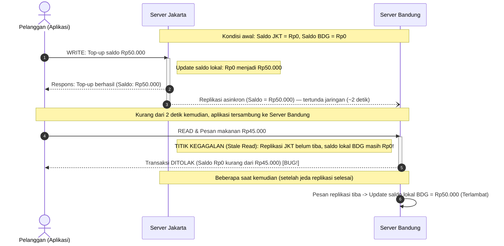
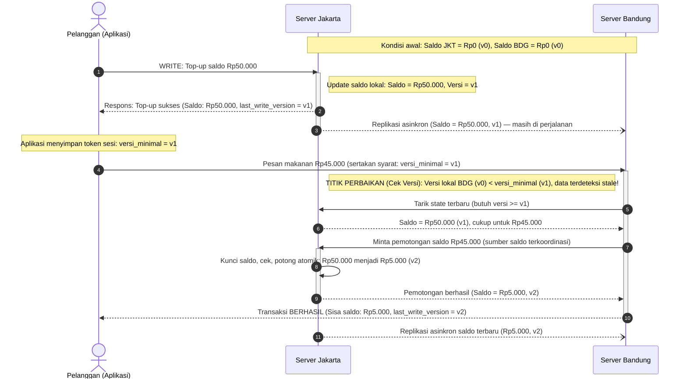

# Tugas 7 (Pekan 7) — Konsistensi Data

**Materi terkait:** Data-Centric Consistency (Sequential, Eventual), Client-Centric Consistency.

## Studi Kasus

Data saldo *e-wallet* pelanggan FoodGo berbeda antara server wilayah **Jakarta** dan **Bandung** karena replikasi antar server berjalan lambat. Contoh kasus nyata: pelanggan top-up saldo lewat server Jakarta, lalu dalam hitungan detik memesan makanan lewat aplikasi yang tersambung ke server Bandung — saldo belum ter-update, transaksi ditolak padahal saldo sebenarnya cukup.

## Tugas Kelompok

### Bagian 1 — Analisis (wajib)

1. Tentukan: apakah kasus ini **membutuhkan Sequential Consistency** (semua replika melihat urutan operasi yang sama) atau **cukup Eventual Consistency** (replika akan konsisten "pada akhirnya", boleh sementara berbeda)? Berikan argumen berbasis dampak bisnis (mis. kasus saldo *e-wallet* jauh lebih sensitif dibanding kasus "jumlah like" di media sosial).
2. Jika kalian menyimpulkan Eventual Consistency saja **tidak cukup** untuk skenario ini, usulkan pendekatan **Client-Centric Consistency** yang relevan (mis. *Read-Your-Writes*: pelanggan yang baru top-up harus selalu melihat saldo terbarunya sendiri, walau replika lain belum sinkron).
3. Gambarkan **diagram alir urutan (sequence diagram)** yang menunjukkan operasi read/write antara pelanggan, server Jakarta, server Bandung, dan proses replikasi — untuk skenario **tanpa** jaminan konsistensi (bug terjadi) DAN skenario **dengan** solusi yang kalian usulkan (bug teratasi). Pakai Mermaid (`sequenceDiagram`) di `README.md` — lihat contoh cara pakai di Tugas 2.

### Bagian 2 — Simulasi (opsional, nilai tambah)

Skeleton `src/replica_simulation.py` mensimulasikan dua replika (Jakarta & Bandung) dengan delay replikasi buatan. Lengkapi TODO untuk:
1. Menunjukkan kondisi **inconsistent read** (replika Bandung masih menunjukkan saldo lama walau Jakarta sudah update).
2. Mengimplementasikan mekanisme **Read-Your-Writes** sederhana (mis. dengan version/timestamp per client) yang memperbaiki masalah tersebut.

```bash
python3 src/replica_simulation.py
```

## Struktur Submission

```
tugas-07-konsistensi-data/
├── README.md      # Analisis konsistensi + sequence diagram Mermaid
├── JURNAL.md
├── src/            # (opsional) simulasi replikasi
└── bukti/          # (jika mengerjakan simulasi) output program
```

## Rubrik Penilaian (Tugas 7)

| Komponen | Bobot | Kriteria |
|---|---|---|
| Ketepatan pemilihan model konsistensi | 30% | Argumen berbasis dampak bisnis nyata, bukan hafalan definisi |
| Kualitas sequence diagram | 30% | Menunjukkan jelas titik kegagalan & titik perbaikan |
| Usulan solusi client-centric | 25% | Solusi konkret dan dapat diimplementasikan (bukan wacana abstrak) |
| Proses & kontribusi kelompok | 15% | `JURNAL.md`, commit history (+ bonus jika simulasi dikerjakan) |

## Batasan Penggunaan AI (Level 2)

Kebijakan **Level 2 (AI Assisted Idea Generation & Structuring)** berlaku — lihat [`../RUBRIK-UMUM.md`](../RUBRIK-UMUM.md). Boleh bertanya konsep umum consistency model ke AI untuk brainstorming; **tidak boleh** meminta AI menuliskan analisis akhir/sequence diagram atau isi `# TODO` di `src/replica_simulation.py` yang tinggal ditempel. Catat pemakaian AI di "Log Penggunaan AI" pada `JURNAL.md`.

- Sebagai bukti pemahaman konsep (bukan hafalan jawaban skenario FoodGo saja), `README.md` wajib menyertakan **satu skenario tambahan** yang kalian buat sendiri (mis. kasus lain di aplikasi ojek online) dan menentukan model konsistensi yang tepat untuk skenario tambahan tersebut.

## 1. Analisis Model Konsistensi

### 1.1 Ringkasan masalah

Pelanggan melakukan top-up Rp50.000 melalui server Jakarta. Dua detik kemudian ia memesan makanan senilai Rp45.000 melalui aplikasi yang tersambung ke server Bandung. Replikasi Jakarta → Bandung belum selesai, sehingga Bandung masih membaca saldo Rp0 dan **menolak transaksi padahal saldo sebenarnya cukup**.

Masalah ini bukan sekadar "data telat tampil". Karena saldo adalah data yang nilainya ditentukan oleh *urutan* operasi (top-up, pembayaran, refund, potongan promo), perbedaan antar replika bisa menghasilkan angka akhir yang salah, bukan hanya angka yang sementara usang.

### 1.2 Dua model yang dipertimbangkan

| | Sequential Consistency | Eventual Consistency |
|---|---|---|
| Jaminan | Semua replika melihat urutan operasi yang sama; urutan operasi tiap klien tetap terjaga | Jika tidak ada update baru, semua replika akhirnya sama; di antaranya boleh berbeda |
| Keunggulan | Tidak ada urutan terbalik atau saldo "salah hitung" akibat operasi yang diproses dengan urutan berbeda | Cepat, tetap tersedia walau koneksi antar server lambat atau putus |
| Harga yang dibayar | Perlu koordinasi antar server, sehingga latensi lebih tinggi dan ketersediaan turun saat jaringan bermasalah | Ada jendela waktu data basi dan potensi konflik penulisan |

### 1.3 Dampak bisnis per operasi

Kasus ini dinilai per operasi, bukan "saldo" secara umum:

| Operasi | Jika konsistensi lemah (Eventual) | Dampak bisnis |
|---|---|---|
| Top-up di Jakarta, lalu baca di Bandung | Saldo belum terlihat | Transaksi ditolak padahal saldo cukup; pesanan batal, pelanggan kecewa |
| Dua pembayaran hampir bersamaan di Jakarta dan Bandung | Kedua server menyetujui berdasarkan saldo lama (contoh: saldo Rp50.000, dua pesanan masing-masing Rp40.000, keduanya lolos) | ***Double spending***: saldo menjadi −Rp30.000, kerugian langsung bagi FoodGo |
| Refund atau potongan promo | Diterapkan dengan urutan berbeda di tiap replika | Saldo akhir tidak sama antar server, memicu komplain dan sengketa |
| Menampilkan riwayat transaksi | Beberapa entri terlambat muncul | Dampak kecil; hanya tampilan |

Tiga alasan utama mengapa saldo tidak boleh dibiarkan hanya Eventual:

1. **Dampak finansial langsung.** Saldo adalah uang pelanggan. Saldo negatif atau salah hitung adalah kerugian nyata, bukan sekadar ketidaknyamanan.
2. **Dampak kepercayaan.** Pelanggan yang pernah ditolak transaksinya padahal sudah top-up cenderung tidak lagi mempercayakan dana di aplikasi tersebut. Biaya kehilangan pelanggan lebih besar daripada biaya latensi tambahan.
3. **Kewajiban atas dana pelanggan.** Layanan *e-wallet* menyimpan dana pelanggan, sehingga ketidaksesuaian saldo antar sistem sulit dipertanggungjawabkan dan menyulitkan rekonsiliasi.

### 1.4 Pembanding: "jumlah like" di media sosial

Pada kasus *like*, dua server menampilkan 1.204 dan 1.207 *like* selama beberapa detik. Tidak ada pihak yang dirugikan, tidak ada keputusan bernilai uang yang diambil dari angka itu, dan perbedaannya hilang dengan sendirinya. Di sini **Eventual Consistency cukup dan justru lebih tepat**, karena mengutamakan kecepatan dan ketersediaan tanpa biaya bisnis berarti.

Perbedaan mendasarnya: pada *like*, kesalahan sementara **tidak berdampak**; pada saldo, kesalahan sementara **bisa menolak transaksi sah atau meloloskan transaksi yang seharusnya gagal**.

### 1.5 Trade-off yang diakui

Menerapkan konsistensi kuat pada semua data FoodGo tidak efisien. Jarak Jakarta–Bandung menambah latensi koordinasi pada setiap operasi, dan jika link antar server terputus, operasi tulis saldo bisa tertahan. Karena itu pilihan model sebaiknya **dibedakan menurut jenis data**, bukan satu model untuk seluruh sistem.

### 1.6 Kesimpulan

| Jenis data | Model yang dipilih | Alasan |
|---|---|---|
| Saldo *e-wallet* (top-up, pembayaran, refund) | **Sequential Consistency** untuk operasi yang mengubah saldo | Urutan operasi menentukan angka akhir; kesalahan berarti kerugian uang dan hilangnya kepercayaan |
| Data non-kritis (rating, popularitas menu, jumlah ulasan) | **Eventual Consistency** | Selisih sementara tidak berdampak bisnis; mengutamakan kecepatan dan ketersediaan |

**Catatan penting.** Sequential Consistency menjamin semua replika sepakat pada satu urutan operasi, sehingga mencegah *double spending* dan saldo salah hitung. Namun model ini tidak otomatis menjamin bahwa pembacaan segera setelah top-up pasti melihat nilai terbaru dari sudut pandang pelanggan yang berpindah server. Untuk gejala spesifik itu (saldo belum terlihat padahal pelanggan baru saja top-up), diperlukan jaminan sisi klien, yaitu ***Read-Your-Writes***, yang dibahas pada bagian usulan solusi client-centric.

## 2. Usulan Solusi Client-Centric Consistency

### 2.1 Masalah yang ingin diselesaikan

Berdasarkan kasus FoodGo, pelanggan melakukan top-up sebesar Rp50.000
melalui server Jakarta. Dua detik kemudian, pelanggan memesan makanan
senilai Rp45.000 melalui server Bandung.

Namun, karena proses replikasi data dari Jakarta ke Bandung belum
selesai, server Bandung masih membaca saldo Rp0. Akibatnya, transaksi
ditolak meskipun pelanggan sebenarnya sudah memiliki saldo yang cukup.

Untuk mengatasi masalah tersebut, FoodGo dapat menerapkan pendekatan
**Client-Centric Consistency**, khususnya menggunakan mekanisme
**Read-Your-Writes**.

### 2.2 Penerapan Read-Your-Writes

Read-Your-Writes merupakan jaminan konsistensi yang memastikan bahwa
setiap pelanggan dapat melihat hasil perubahan data yang sebelumnya
telah dilakukan sendiri.

Penerapannya pada FoodGo adalah sebagai berikut:

1.  Pelanggan melakukan top-up sebesar Rp50.000 melalui server Jakarta.
2.  Server Jakarta memproses top-up dan memperbarui saldo pelanggan
    menjadi Rp50.000.
3.  Sistem mengirimkan konfirmasi bahwa top-up berhasil kepada
    pelanggan.
4.  Ketika pelanggan berpindah ke server Bandung untuk melakukan
    pemesanan, sistem memastikan bahwa pembacaan saldo pelanggan sudah
    mencerminkan hasil top-up sebelumnya.
5.  Jika replikasi dari Jakarta ke Bandung belum selesai, sistem dapat
    mengarahkan pembacaan saldo ke server Jakarta atau mengambil data
    terbaru dari sumber saldo yang konsisten.
6.  Pelanggan dapat melakukan pemesanan makanan sebesar Rp45.000 karena
    saldo terbaru sudah terbaca.

### 2.3 Manfaat penerapan Read-Your-Writes

Beberapa manfaat yang diperoleh FoodGo dari penerapan pendekatan ini
adalah:

1.  **Menghindari penolakan transaksi yang tidak semestinya.** Pelanggan
    yang baru melakukan top-up tidak akan ditolak hanya karena server
    lain belum menerima pembaruan saldo.
2.  **Meningkatkan pengalaman pelanggan.** Pelanggan dapat melihat saldo
    terbaru setelah melakukan top-up tanpa harus menunggu seluruh
    replika selesai melakukan sinkronisasi.
3.  **Menjaga kepercayaan pelanggan.** Informasi saldo yang ditampilkan
    sesuai dengan transaksi yang telah dilakukan pelanggan.
4.  **Mengurangi ketergantungan pada sinkronisasi seluruh replika.**
    Sistem dapat memastikan pembacaan saldo pelanggan menggunakan sumber
    data yang sudah memiliki pembaruan terbaru.

### 2.4 Kesimpulan

Berdasarkan permasalahan tersebut, FoodGo dapat menggabungkan
**Sequential Consistency dan Client-Centric Consistency
(Read-Your-Writes)** untuk pengelolaan saldo e-wallet.

Sequential Consistency digunakan untuk memastikan operasi perubahan
saldo memiliki urutan yang konsisten sehingga dapat mencegah kesalahan
perhitungan dan double spending. Sementara itu, Read-Your-Writes
memastikan pelanggan dapat melihat hasil top-up yang baru saja dilakukan
meskipun sedang berpindah server.

Dengan pendekatan tersebut, FoodGo dapat menjaga keamanan transaksi
sekaligus memberikan pengalaman penggunaan aplikasi yang lebih baik.

**Catatan teknis:** Read-Your-Writes saja tidak cukup untuk mencegah
double spending. Pemeriksaan dan pemotongan saldo tetap harus dilakukan
secara atomik melalui sumber data yang terkoordinasi, misalnya transaksi
database dengan penguncian atau mekanisme konsensus. Jadi, kedua
pendekatan tersebut saling melengkapi.

## 3. Diagram Alir Urutan (Sequence Diagram)

Bagian ini menggambarkan perbandingan alur operasi *write* (top-up) dan *read* (pengecekan saldo saat memesan makanan) antara **Pelanggan**, **Server Jakarta**, dan **Server Bandung** beserta proses replikasinya.

### 3.1 Skenario Tanpa Jaminan Konsistensi (Bug Terjadi — *Inconsistent / Stale Read*)

Pada skenario naif (*Eventual Consistency* murni tanpa jaminan sisi klien), server langsung membalas berhasil ke pelanggan setelah mencatat top-up secara lokal di Jakarta, sementara replikasi ke Bandung berjalan secara asinkron di latar belakang. Ketika pelanggan berpindah koneksi ke Server Bandung sebelum replikasi tiba, Server Bandung langsung membaca data lokalnya yang masih usang (*stale*).



**Penjelasan titik kegagalan:**
1. **Langkah 1–3:** Pelanggan melakukan *write* (top-up Rp50.000) ke Server Jakarta. Server Jakarta memperbarui saldonya menjadi Rp50.000, langsung mengirim konfirmasi sukses ke pelanggan, dan memulai pengiriman pesan replikasi asinkron ke Server Bandung.
2. **Langkah 4–5 (*Titik Kegagalan*):** Dalam waktu kurang dari 2 detik (sebelum pesan replikasi sampai di Bandung), pelanggan memesan makanan seharga Rp45.000 melalui Server Bandung. Karena tidak ada pemeriksaan versi data, Server Bandung langsung membaca saldo lokalnya yang masih **Rp0** (*stale read*) dan menolak transaksi meskipun pelanggan baru saja menerima bukti top-up berhasil.
3. **Langkah 6:** Data replikasi baru tiba di Server Bandung setelah transaksi telanjur ditolak.

---

### 3.2 Skenario Dengan Solusi *Read-Your-Writes* (Bug Teratasi)

Pada skenario dengan jaminan **Client-Centric Consistency (*Read-Your-Writes*)**, setiap operasi perubahan saldo menghasilkan nomor versi (*version stamp* / token sesi) yang disimpan oleh aplikasi pelanggan. Ketika pelanggan bertransaksi lewat server lain, aplikasi menyertakan versi minimal (`versi_minimal`) yang pernah dilihatnya. Server tujuan wajib memastikan datanya minimal sama baru dengan versi tersebut sebelum memproses transaksi.



**Penjelasan titik perbaikan:**
1. **Langkah 1–3 (Pencatatan Versi Penulisan):** Saat top-up Rp50.000 diproses di Server Jakarta, server menaikkan versi data pelanggan menjadi `v1` dan mengembalikan `last_write_version = v1` ke aplikasi pelanggan. Aplikasi menyimpan `versi_minimal = v1` di sesi klien.
2. **Langkah 4 (*Titik Perbaikan*):** Saat pelanggan memesan makanan Rp45.000 ke Server Bandung, aplikasi menyertakan metadata `versi_minimal = v1`. Server Bandung memeriksa versi lokalnya (`v0`) dan mendeteksi bahwa `v0 < v1` (replikasi asinkron pada langkah 3 belum tiba).
3. **Langkah 5–6 (Sinkronisasi / Redirect ke Sumber Konsisten):** Alih-alih langsung menolak pesanan menggunakan saldo Rp0, Server Bandung menahan pembacaan lokal dan menarik data terbaru dari Server Jakarta (atau menunggu hingga replikasi `v1` tiba). Saldo yang terbaca kini Rp50.000 (`v1`), sehingga cukup untuk pesanan Rp45.000.
4. **Langkah 7–9 (Pemotongan Saldo Terkoordinasi):** Server Bandung tidak memotong saldo secara lokal, tetapi meneruskan permintaan pemotongan ke Server Jakarta sebagai sumber saldo yang terkoordinasi. Jakarta mengunci saldo, memeriksa, dan memotongnya secara atomik menjadi Rp5.000 (`v2`). Dengan begitu, dua pembayaran hampir bersamaan dari server berbeda tidak bisa sama-sama lolos memakai saldo lama (*double spending* tercegah, sesuai kesimpulan bagian 1.6).
5. **Langkah 10–11:** Pelanggan menerima konfirmasi transaksi berhasil beserta `last_write_version = v2` sebagai token sesi berikutnya, lalu Jakarta mereplikasi saldo terbaru ke Bandung secara asinkron. Pelanggan selalu melihat hasil aksinya sendiri (*Read-Your-Writes*), sementara urutan perubahan saldo tetap terjaga (*Sequential Consistency*).

## 4. Skenario Tambahan: Lokasi Driver pada Aplikasi Ojek Online

### 4.1 Kasus
Aplikasi ojek online "GoRide" menampilkan posisi driver secara real-time di peta pelanggan.
Driver mengirim koordinat GPS setiap 3 detik ke server terdekat (mis. Surabaya), lalu data
direplikasi ke server lain (mis. Jakarta) secara asinkron. Pelanggan yang tersambung ke
server Jakarta bisa melihat posisi driver yang tertinggal beberapa detik.

### 4.2 Model yang dipilih: Eventual Consistency + Monotonic Reads

| Pertimbangan | Analisis |
|---|---|
| Dampak data basi | Posisi driver tertinggal 3–5 detik (± puluhan meter). Tidak ada uang yang berpindah dan tidak ada keputusan transaksi yang diambil dari angka ini |
| Data cepat usang dengan sendirinya | Koordinat lama langsung digantikan update berikutnya, jadi selisih hilang sendiri dalam hitungan detik |
| Biaya konsistensi kuat | Update datang setiap 3 detik dari ribuan driver. Koordinasi antar server untuk tiap update akan membebani jaringan dan membuat peta justru lebih lambat |
| Masalah yang tetap perlu dicegah | Jika pelanggan bergantian membaca dari dua replika berbeda, ikon driver bisa "melompat mundur" (posisi baru, lalu posisi lama). Ini membingungkan pelanggan |

Karena itu dipilih **Eventual Consistency** (cukup, karena data basi tidak merugikan),
ditambah jaminan client-centric **Monotonic Reads**: aplikasi menyimpan timestamp
koordinat terakhir yang sudah ditampilkan, dan mengabaikan data dengan timestamp lebih lama.
Dengan begitu posisi driver tidak pernah tampil mundur.

### 4.3 Perbandingan dengan FoodGo
Pada FoodGo, data basi bisa **menolak transaksi sah atau meloloskan double spending**, sehingga
butuh Sequential Consistency + Read-Your-Writes. Pada lokasi driver, data basi hanya membuat
tampilan sedikit tertinggal, sehingga Eventual Consistency lebih tepat. Model konsistensi
dipilih berdasarkan dampak kesalahan, bukan berdasarkan jenis aplikasinya.

## 5. Simulasi (Bagian 2)
Simulasi ada di `src/replica_simulation.py` (jalankan: `python3 src/replica_simulation.py`),
output ada di `bukti/`. Hasil: pembacaan naif dari Bandung mengembalikan saldo 0 (stale read),
sedangkan Read-Your-Writes (redirect maupun polling) selalu mengembalikan saldo terbaru.
